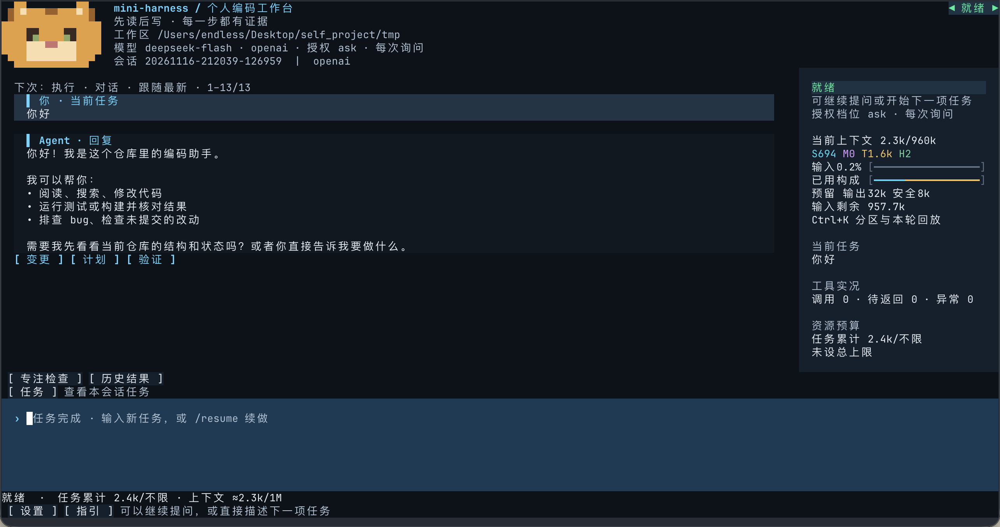
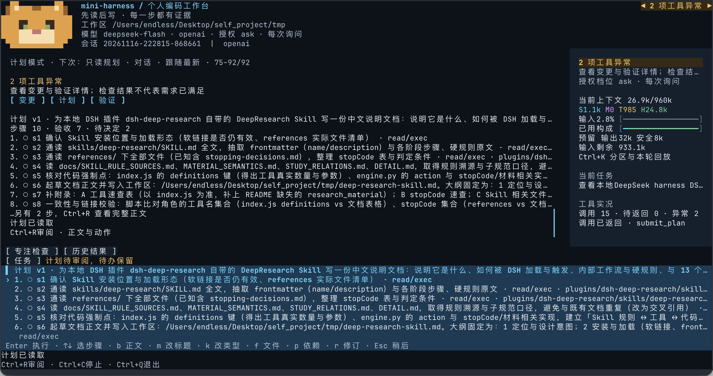
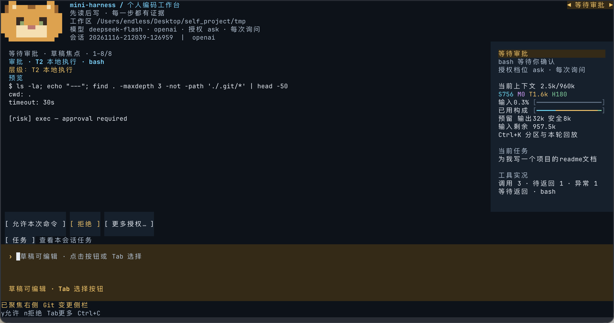
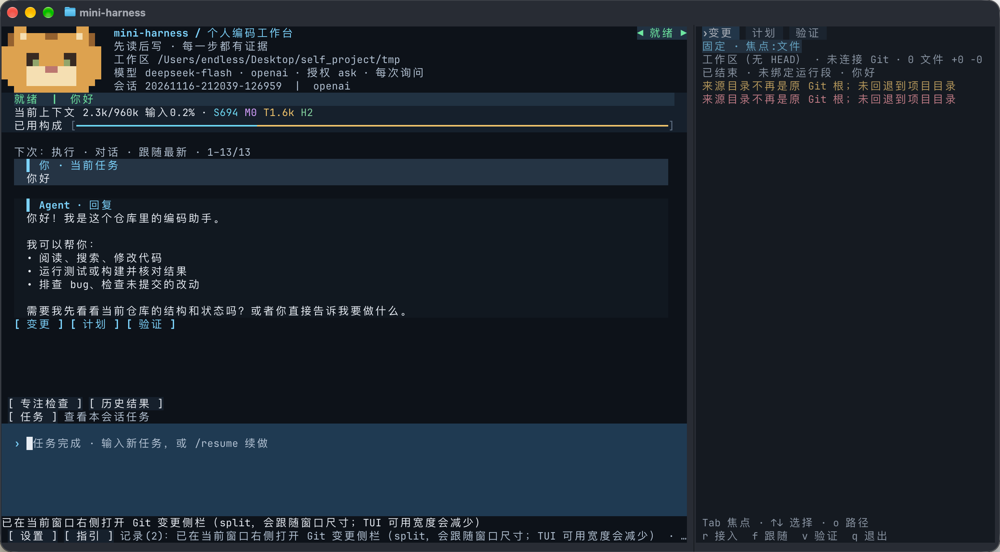

<p align="center">
  
</p>

<h1 align="center">mini-harness</h1>

<p align="center">
  <strong>一只陪你写代码的终端小猫，一个可以读懂的 Coding Agent。</strong><br>
  阅读仓库、审阅计划、批准改动、运行验证，在终端里完成一个编码任务。
</p>

<p align="center">
  <a href="https://www.python.org/"></a>
  <a href="https://nodejs.org/"></a>
  <a href="LICENSE"></a>
  
</p>

<p align="center">
  <a href="#快速安装">快速安装</a> ·
  <a href="#界面预览">界面预览</a> ·
  <a href="#开始你的第一个任务">开始使用</a> ·
  <a href="docs/USAGE.md">使用指南</a> ·
  <a href="CONTRIBUTING.md">参与贡献</a>
</p>

## 为什么是 mini-harness

mini-harness 是一个开源的终端编码工作台，也是一份可以运行、阅读和修改的 Agent 实现。它面向希望亲自掌控编码过程的开发者：把任务交给模型，同时看清它读了什么、准备改什么，以及结果是否经过验证。

- **进入项目就能用**：在任意目录输入 `mini-harness`，当前目录就是工作区；模型连接在不同项目间复用。
- **计划与执行都可审阅**：先看计划，再决定是否执行；写文件、执行命令经过审批，运行中可以纠偏或取消。
- **完成不止是一句回复**：查看实际 Git 改动、命令退出状态和验证记录，分清已验证、未验证与失败。
- **工作可以接着做**：保存会话、查找历史、显式恢复任务；支持计划进度与后台任务管理。
- **按需接入工具**：支持 OpenAI 兼容模型、Skills 与 MCP；前台外部服务按需连接。
- **Agent 原理可阅读**：Python 标准库构成核心 harness，应用后端与 React / Ink 界面分层，便于学习和扩展。

> 当前处于早期开发阶段，以单 Agent 编码任务为主。从源码安装；主要在 macOS 验证，Linux / WSL 可尝试，部分终端集成与沙箱功能依赖平台。原生 Windows 暂不支持。

## 界面预览



<p align="center"><em>主工作台：从当前项目开始，在对话中阅读代码、提出修改并跟进结果。</em></p>

<table>
  <tr>
    <td width="33%" align="center"><strong>先审阅计划</strong></td>
    <td width="33%" align="center"><strong>再批准操作</strong></td>
    <td width="33%" align="center"><strong>查看变更侧栏</strong></td>
  </tr>
  <tr>
    <td><a href="docs/assets/plan-review.png"></a></td>
    <td><a href="docs/assets/approval.png"></a></td>
    <td><a href="docs/assets/verification.png"></a></td>
  </tr>
  <tr>
    <td>看清步骤、目标文件与验收方式。</td>
    <td>核对即将执行的命令或文件修改。</td>
    <td>在侧栏切换变更、计划与验证信息。</td>
  </tr>
</table>

点击图片可查看原图。截图维护说明见[截图指引](docs/assets/screenshots/README.md)。

## 快速安装

需要 **Git、Python 3.11+、Node.js 22+（含 npm）**。建议 Python 3.12。请使用交互式终端；已安装 [uv](https://docs.astral.sh/uv/) 时启动器优先使用它，否则自动使用 Python venv / pip。

### 1. 克隆并启动

以下将源码放在固定的用户目录，方便后续配置全局命令：

```bash
git clone https://github.com/wj-spec/mini-harness.git "$HOME/.local/share/mini-harness"
cd "$HOME/.local/share/mini-harness"
./start.sh
```

首次启动会检查环境，经确认安装 Python 与前端依赖；缺少模型配置时打开配置页。默认 DeepSeek 通常只需填写 API Key，其他 OpenAI 兼容服务可填写地址、模型名和 Key。保存后按提示检测连接并进入项目。

依赖安装需要联网。真实模型使用你自己的服务商账号并按其规则计费；已有依赖和模型配置会在后续启动时复用。

**无需 Key，先体验完整流程：**

```bash
./start.sh --demo
```

Demo 会预填本地任务：创建 `.vibe/fake-demo.txt` 并验证。按 Enter 开始，依提示审批，查看最后的验证回执。首次仍需安装依赖，Demo 任务不调用模型 API。

### 2. 配置 `mini-harness` 命令

按上面的固定目录安装后，选择你的 shell，执行一次：

**zsh（macOS 默认）**

```bash
printf '\nmini-harness() { "$HOME/.local/share/mini-harness/start.sh" "$@"; }\n' >> ~/.zshrc
source ~/.zshrc
```

<details>
<summary>bash（Linux / WSL 常见）</summary>

```bash
printf '\nmini-harness() { "$HOME/.local/share/mini-harness/start.sh" "$@"; }\n' >> ~/.bashrc
source ~/.bashrc
```

</details>

如果源码放在其他位置，把函数中的路径改成该目录下 `start.sh` 的绝对路径。此命令依赖本地源码目录，请保留它。

现在，到你想操作的项目目录运行：

```bash
cd /path/to/your/project
mini-harness
```

当前目录就是工作区。模型配置供所有项目复用，会话和运行记录写入各自工作区的 `.vibe/`。

## 开始你的第一个任务

先让它了解仓库：

> 阅读 README 和主要入口，解释这个项目如何运行，并列出我应该先看的三个文件。先不要修改代码。

再给一个有明确验收方式的修改任务：

> 修复空输入触发异常的问题。先复现并给出修改计划，确认后补充回归测试、实现修复，再运行相关测试。

| 操作 | 命令 / 按键 |
| --- | --- |
| 发送 / 换行 | Enter / Ctrl+J |
| 取消当前任务 / 退出 | Ctrl+C / Ctrl+Q |
| 操作帮助 | `/help` |
| 查看和更换模型 | `/model` |
| 预算、模型与工具设置 | `/settings` |
| 查看计划完整清单 | Ctrl+L（执行计划时） |
| 查看验证证据 | `/evidence` |
| 查看实际改动 | `/diff` |
| 浏览旧会话 / 显式续做 | `/sessions` / `/resume` |

```bash
mini-harness --continue                  # 打开当前项目最近的会话
mini-harness --workspace /path/to/repo   # 指定其他工作区
mini-harness --doctor                    # 本地环境与配置检查
mini-harness --demo                      # 不调用真实模型的演示
```

恢复会话不会自动执行任务；确认上下文后输入新需求或 `/resume`。更多交互见[使用指南](docs/USAGE.md)。

## 模型与配置

支持 **OpenAI 兼容的 Chat Completions 接口**；用于编码的模型需要支持工具调用。默认提供 DeepSeek 配置入口，也可以接入其他兼容服务。

| 配置 / 数据 | 默认位置 |
| --- | --- |
| 用户模型与设置 | `~/.config/mini-harness/config.toml` |
| 独立 API 凭据 | `~/.config/mini-harness/credentials.json`，权限 `0600` |
| 项目覆盖（可选） | 工作区 `.mini-harness/config.toml` |
| 会话、日志与运行产物 | 工作区 `.vibe/` |

支持 `XDG_CONFIG_HOME`。普通模型选项按 **命令行 → shell 环境 → 项目覆盖 → 用户配置 → 旧安装 `.env` → 默认值** 决定优先级。项目配置不保存 Key；更换服务地址不会自动沿用原服务的文件凭据。

进入工作台后使用 `/model` 管理连接：**保存**供后续启动复用，**应用**切换后续新任务，**检测**发出最小请求验证连接。保存与检测经过审批；检测可能产生少量费用。`--doctor` 只做本地检查，不验证远端 Key 是否有效。

配置格式、代理和旧配置兼容见[配置指南](docs/CONFIGURATION.md)。

## 更新与排错

在保留本地改动的前提下更新源码，再同步依赖：

```bash
cd "$HOME/.local/share/mini-harness"
git pull --ff-only
./start.sh --install
```

如果 Git 提示存在冲突或分支分叉，先处理自己的改动，不要覆盖它们。更新后重新启动工作台。

| 遇到的问题 | 处理方法 |
| --- | --- |
| `mini-harness: command not found` | 完成上面的 shell 配置，重新打开终端或 source 对应配置文件 |
| 提示找不到 Python / Node.js | 检查 `python3 --version`、`node --version` 和 `npm --version` |
| 依赖下载中断 | 检查网络后重新运行 `./start.sh --install` |
| 尚未准备 API Key | 使用 `mini-harness --demo`；自检可用 `mini-harness --doctor --fake` |
| 保存了模型但没有生效 | 检查命令行、环境变量或项目覆盖；保存后重启或显式应用 |

## 了解 Agent 是怎样工作的

```text
终端交互（React / Ink）
          │ JSONL / stdio
应用后端（Python）── 模型、工具、审批、会话
          │
核心 harness（Python 标准库）── 任务循环、上下文、预算与契约
```

| 目录 | 内容 |
| --- | --- |
| `core/` | 可复用 harness，只依赖 Python 标准库 |
| `app/` | 模型接入、工具、审批、会话与运行编排 |
| `tui/` | React / Ink 终端界面 |
| `scripts/` | 安装准备、环境检查与开发辅助脚本 |
| `docs/` | 使用说明、设计、研究与验证记录 |

从[Harness 技术方案](docs/HARNESS.md)和[目录地图](docs/STRUCTURE.md)开始阅读。配置解析与凭据边界位于 `app/runtime/user_config.py`。后续方向见[建设方向](docs/roadmap.md)，已完成与待验收能力以[里程碑](docs/MILESTONES.md)为准。

## 参与贡献

欢迎提交可复现的 bug、使用反馈、文档和代码改进。较大的功能调整，先在 [Issues](https://github.com/wj-spec/mini-harness/issues) 讨论具体使用场景。

开发环境、测试命令与 PR 约定见[贡献指南](CONTRIBUTING.md)。日常操作见[使用指南](docs/USAGE.md)，完整资料见[文档导航](docs/README.md)。

工作台在本地运行；使用远程模型时，任务上下文会发送到所配置的服务。命令以当前用户权限执行，审批不能替代系统沙箱。当前平台支持与可选隔离方式见[使用指南](docs/USAGE.md)。

## License

[MIT](LICENSE) © 2026 wj-spec
