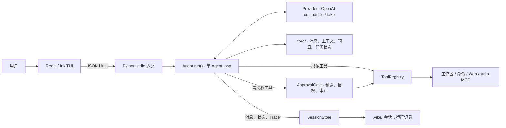

# mini-harness

一个以终端为入口的本地 Coding Agent。当前采用单进程、单 Agent loop：模型提出下一步，Python harness 负责组装上下文、审批动作、执行工具并记录结果。

随着 Agent 能执行的步骤增多，最终回答不足以说明它依据了什么、实际做了什么，以及验证是否真的通过。这个项目尝试让这些过程有据可查，并以此为基础，逐步发展为更了解用户的个人助手工作台。

## 当前能力

界面入口是 React/Ink 工作台，通过本地 JSON Lines 连接 Python Agent；Textual 入口已于 2026-10-23 退役。当前已接通：

- **编码与工具**：读取、搜索、修改工作区文件，运行命令、联网检索，通过 stdio MCP 接入外部工具。
- **模型与技能**：OpenAI-compatible 流式接口、本地 fake 模式，以及 Skill 的发现、加载和卸载；加载 Skill 不授予额外工具权限。
- **过程控制**：运行中纠偏、排队后续任务、拒绝审批、取消与超时处理；取消后仍需核对已发生的修改。
- **上下文与恢复**：预算控制、历史压缩、原文回取、上下文快照，以及会话保存和显式 `/resume` 续做。
- **执行证据**：命令状态与退出码、审批审计、消息与运行记录、独立评测入口。
- **右侧变更侧栏**：在 Ghostty 右侧 quick terminal 打开独立侧栏，只读跟随工作区 Git 变更与 diff，不改变主工作台布局（`/sidebar` 或 `Ctrl+G`；见[使用指南](docs/USAGE.md#右侧-git-变更侧栏ghostty)）。

这些能力的工程实现与真实任务验收分别记录在[工作台里程碑](docs/MILESTONES.md)。fake 模式用于离线检查交互与协议；会话恢复服务于同一任务，项目背景（W4）与个人偏好（W5）已交付，但 W6 收益对照未观察到重复说明减少，个性化收益尚未成立。

## 架构



[`core/`](core/) 只依赖 Python 标准库，负责可复用的消息、预算、上下文与任务状态；模型接入、工具和执行流程在 [`app/`](app/)。Ink 通过 stdio 后端调用同一个 [`Agent.run()`](app/agent.py)，界面更换不会产生第二套执行逻辑。

## 核心设计

1. **模型提议动作，harness 决定执行。** Agent 对非只读工具先生成预览，再经过 [`ApprovalGate`](app/policy.py)；没有审批处理器时默认拒绝。授权可限定为单次或精确规则，内置写入与命令还可按工作区授权，支持撤销和审计；MCP 服务启动另行审批。命令仍以当前用户权限运行，审批和超时不构成操作系统级沙箱。
2. **从实际请求观察上下文。** [`ContextBuilder`](core/context.py) 控制预算、压缩旧历史，并用引用保留可回取的原文。模型请求前的[上下文快照](core/context_snapshot.py)按最终组装的消息和工具定义统计来源、分区及估算用量；`/context` 可以查看变化。这里展示的是可核对的输入构成，token 分区数字是估算值，不是模型生成的行为解释。
3. **把执行结果与恢复状态当作证据。** 命令结果保留退出码，以及成功、失败、超时、取消等状态；工具结果回灌模型并写入任务记录。[`SessionStore`](app/session.py)保存原始消息、状态和运行轨迹；打开旧会话不会自动重放可能已生效的动作，显式输入 `/resume` 后才继续。结果未知时，先核对实际文件和命令结果。

## 快速体验

需要 Python 3.11+、`uv` 和 Node.js 22+。以下命令启动无需模型 API 的界面演示：

```bash
uv sync --extra test
npm --prefix tui ci
./run_ink.sh --fake
```

配置 `VIBE_API_KEY`、`VIBE_BASE_URL`、`VIBE_MODEL` 后，可以用 `./scripts/demo.sh` 在临时示例仓库里体验真实编码任务。

安装、模型配置与操作方式见[使用指南](docs/USAGE.md)；演示步骤见[三分钟 Demo](docs/DEMO.md)。fake 模式用于确定性接线检查，不代表真实模型的任务完成效果。

## 验证

Python 回归使用 `./run_tests.sh -q`，Ink 构建与测试使用 `npm --prefix tui test`。预算机制可先离线检查：

```bash
./run_eval.sh check-budget
```

它使用确定性 fake 模型，不需要 API Key 或 Docker，按上下文容量、压缩继续、累计预算暂停逐层验证，前层未通过则跳过后层。已有一次 CLI 检查 3/3 层通过；预期暂停通过只说明机制正确。真实编码验收依次运行内部 1/3 题、SWE-bench Lite 首题和固定 3 题；公开入口当前默认 1 题，显式 `--limit 3` 再扩展。评分器自检 `./run_eval.sh validate` 默认验第一题，`--limit 3` 可对固定前三题做空补丁/参考补丁自检，结果逐题写入 `validation.json`。本地基准的 `--runs` 记录多次运行分布，`--pause-tokens` 用低预算触发暂停并以 `--continue` 重开续做，验证恢复链路。macOS 上可用 `--sandbox`（或 `VIBE_SANDBOX=1`）把命令放进 Seatbelt 沙箱：写入限工作区与临时目录、默认断网，`--sandbox-network` 放开；沙箱拒绝会以 `ERROR sandbox_denied` 返回，无法应用时直接拒绝启动。真实评测默认继承本机预算配置，可先用 `./run_eval.sh doctor` 核对。命令、报告与结果分类见[评测规格](docs/specs/evaluation.md)，真实任务完成条件见[工作台里程碑](docs/MILESTONES.md)。

## 当前完善重点

以下是 2026-10-23 结合代码与本地 LLM Wiki 得出的改进建议（[推断]）。2026-10-25 已逐项修复并附针对性回归；真实任务核对与多次评测运行仍待完成，最终交付状态以[工作台里程碑](docs/MILESTONES.md)为准。

| 优先级 | 待完善项与当前缺口 | 建议的完成条件 | 交付状态 |
| --- | --- | --- | --- |
| P0 | **工具工作区边界**：[文件与搜索工具](app/tools.py)的固定临时文件、搜索参数和无 `rg` 时的符号链接处理仍有边界缺口。 | 使用排他创建的随机临时文件；搜索模式与命令选项分离；逐文件校验解析后的路径；错误与无匹配分别返回。回归覆盖临时文件符号链接、选项形式的模式和工作区外链接。 | 已修复（484fb57），回归 `tests/test_tools.py`；真实任务核对待做。 |
| P0 | **流式终止与协议完整性**：[Provider](app/providers/openai_compat.py)对未完整结束的流、[Agent](app/agent.py)对截断工具调用的后续消息配对仍需收紧。 | 不执行未完整接收的工具调用；异常断流明确标为失败或截断；每个已记录的工具调用都有对应结果或未执行说明；同进程续做和重开恢复均通过回归。 | 已修复（a741b17），回归 `tests/test_provider.py`、`tests/test_agent.py`；真实任务核对待做。 |
| P1 | **交付核验**：[Agent](app/agent.py)在交互任务中仍可能以纯文字结束动作请求，最终回复也缺少统一的产物核对。 | 区分问答与动作任务；动作任务未执行时说明阻碍并尊重审批决定；由 harness 汇总本轮起止差异、实际验证及退出码、未验证项，分别呈现运行结束与任务验收。 | 已交付（d0e1479），任务分类为启发式仅影响呈现；回归 `tests/test_delivery_receipt.py`；真实任务核对待做。 |
| P1 | **恢复对账与关键约束**：已有显式续做和进程内文件新鲜度检查，但重开会话后读文件哈希未恢复，较早纠偏也可能被有损摘要压缩。 | 恢复后首次修改已有文件前重新读取；结果未知的动作先核对副作用；当前有效约束单独保留来源和覆盖关系；外部改动、长上下文压缩及多次纠偏均有回归。 | 已修复（4e4f8fa），回归 `tests/test_tools.py`、`tests/test_steering.py`；真实任务核对待做。 |
| P1 | **评测有效性**：[本地评测](scripts/bench_local.py)的 `passed` 主要取决于最终检查退出码，尚未充分区分产物正确、运行完成与可比较性。 | 分别记录这三类结果；取消、越界或改动测试等情况保留证据并按评测协议判定有效性；验证改前失败、改后通过；固定模型、预算与版本，多次运行并加入未参与调优的保留题。 | 已交付（9674537，`--runs`/保留题）；两道 `held_out` 保留题已用真实模型 3 次×2 题核对，6/6 有效且 `verified_fix` 全真（[证据](docs/MILESTONES.md)，报告 `.vibe/bench-local/20261025-141504/summary.json`）。 |
| P1 | **完整工具 Trace**：[TraceRecorder](app/trace.py)已有工具开始、审批和结束接口，主循环尚未统一接入；部分证据需跨记录人工拼接。 | 按 `run_id`、步骤与 `tool_call_id` 关联工具开始、审批、结束、耗时和错误；拒绝、取消、超时均有终态；先用本地记录定位首个异常。 | 已交付（4e920fc），回归 `tests/test_tool_trace.py`；真实任务核对待做。 |

六项均已通过针对性回归；下一步是用真实编码任务核对边界修复与 Trace 证据，并用 `--runs` 多次运行评测确认可比较性，之后在里程碑中登记最终验收。

## 后续方向

当前先把单 Agent 编码任务做得可靠、可理解，再按[开发规划](docs/roadmap.md)验证以下尚未交付的能力：

| 方向 | 当前基础与缺口 | 最小可用范围 |
| --- | --- | --- |
| **受控只读知识库接入** | Skill 可以加载流程说明；常规文件工具受工作区限制，外部知识库内容尚无独立的只读访问范围。 | 显式登记可撤销的知识源目录，按需搜索和分行读取，返回来源与行号或 PDF 页码；读取知识不扩大写入或命令权限。先验证本地文件检索是否足够，再决定索引方式。 |
| **跨任务项目事实（W4）** | 已有项目规则与当前任务的会话状态，尚未形成可维护的跨任务项目记忆。 | 按项目保存经确认的事实和决策，记录来源、版本、更新时间与失效规则；用新任务中减少重复说明来验收。 |
| **“关于你”（W5–W6）** | 用户偏好与个人画像仍处于规划阶段。 | 能查看、确认、纠正和删除，保留来源与时间；区分稳定偏好和临时信息，验证是否减少反复纠正。 |

多 Agent、LSP、其他 MCP transport / 资源 / prompt 能力与新界面，按具体任务收益再评估。当前命令仍以当前用户权限运行；操作系统级隔离需另行设计与验收。

## 知识依据

以上建议使用本地 `endless-llm-wiki` 的来源快照，并结合本项目代码作出推断，不代表资料直接评价过本项目。下列链接要求两个仓库同级放置；单独克隆本项目时需另行准备知识库。页码均为《智能体 AI 权威指南》（yeasy，2026-06-16 来源快照）的 PDF 物理页码：

- [Harness](../endless-llm-wiki/wiki/agentic-ai/agent-harness.md)与[故障恢复](../endless-llm-wiki/wiki/agentic-ai/agent-fault-recovery.md)：执行边界、独立验收、半结果完整性与恢复后环境核对，p.421、459、466–468、495。
- [智能体评估](../endless-llm-wiki/wiki/agentic-ai/agent-evaluation.md)：最终环境状态、重复试验与可比较条件，p.306–307、319–320；另见 [Agent-Interview-100 #111](../endless-llm-wiki/raw/agent-interview-100/files/08-evaluation/111-eval-harness-design.md) L218–236。
- [智能体记忆](../endless-llm-wiki/wiki/agentic-ai/agent-memory.md)与[Skills](../endless-llm-wiki/wiki/agentic-ai/agent-skills.md)：事实更新、关键约束与渐进加载，p.96–97、100–108、178–182。知识源目录与权限范围是本项目的设计建议。
- [可观测性](../endless-llm-wiki/wiki/agentic-ai/agent-observability.md)：关联执行片段、结果、延迟与消耗，p.431–433。

采用 [MIT](LICENSE) 许可证。
