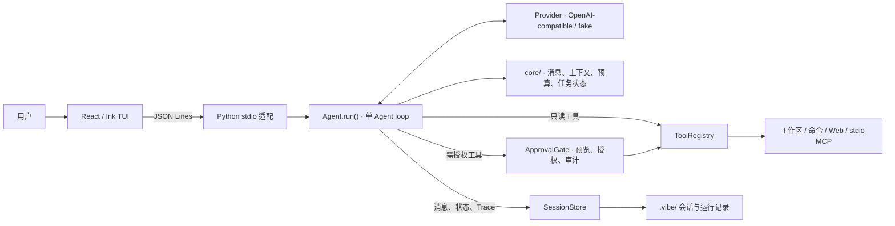

# mini-harness

一个以终端为入口的本地 Coding Agent。当前采用单进程、单 Agent loop：模型提出下一步，Python harness 负责组装上下文、审批动作、执行工具并记录结果。

随着 Agent 能执行的步骤增多，最终回答不足以说明它依据了什么、实际做了什么，以及验证是否真的通过。这个项目尝试让这些过程有据可查，并以此为基础，逐步发展为更了解用户的个人助手工作台。

## 当前能力

支持读取、搜索和修改工作区文件，运行命令、联网检索，并通过 stdio MCP 接入外部工具。模型侧支持 OpenAI-compatible 流式接口；本地 fake 模式可用于不联网地检查交互与协议。界面入口是 React/Ink 工作台，通过本地 JSON Lines 连接 Python Agent；Textual 入口已于 2026-10-23 退役。

## 架构



[`core/`](core/) 只依赖 Python 标准库，负责可复用的消息、预算、上下文与任务状态；模型接入、工具和执行流程在 [`app/`](app/)。Ink 通过 stdio 后端调用同一个 [`Agent.run()`](app/agent.py)，界面更换不会产生第二套执行逻辑。

## 核心设计

1. **模型提议动作，harness 决定执行。** Agent 对非只读工具先生成预览，再经过 [`ApprovalGate`](app/policy.py)；没有审批处理器时默认拒绝。授权可限定为单次或精确规则，内置写入与命令还可按工作区授权，支持撤销和审计；MCP 服务启动另行审批。命令仍以当前用户权限运行，审批和超时不构成操作系统级沙箱。
2. **从实际请求观察上下文。** [`ContextBuilder`](core/context.py) 控制预算、压缩旧历史，并用引用保留可回取的原文。模型请求前的[上下文快照](core/context_snapshot.py)按最终组装的消息和工具定义统计来源、分区及估算用量；`/context` 可以查看变化。这里展示的是可核对的输入构成，token 分区数字是估算值，不是模型生成的行为解释。
3. **把执行结果与恢复状态当作证据。** 命令结果保留退出码，以及成功、失败、超时、取消等状态；工具结果回灌模型并写入任务记录。[`SessionStore`](app/session.py)保存原始消息、状态和运行轨迹；打开旧会话不会自动重放可能已生效的动作，显式输入 `/resume` 后才继续。结果未知时，先核对实际文件和命令结果。

## 快速体验

需要 Python 3.11+、`uv` 和 Node.js 22+。以下命令启动无需模型 API 的界面演示：

```bash
uv sync --extra test
npm --prefix tui ci
./run_ink.sh --fake
```

配置 `VIBE_API_KEY`、`VIBE_BASE_URL`、`VIBE_MODEL` 后，可以用 `./scripts/demo.sh` 在临时示例仓库里体验真实编码任务。

安装、模型配置与操作方式见[使用指南](docs/USAGE.md)；演示步骤见[三分钟 Demo](docs/DEMO.md)。fake 模式用于确定性接线检查，不代表真实模型的任务完成效果。

## 验证

Python 回归使用 `./run_tests.sh -q`，Ink 构建与测试使用 `npm --prefix tui test`。预算机制可先离线检查：

```bash
./run_eval.sh check-budget
```

它使用确定性 fake 模型，不需要 API Key 或 Docker，按上下文容量、压缩继续、累计预算暂停逐层验证，前层未通过则跳过后层。已有一次 CLI 检查 3/3 层通过；预期暂停通过只说明机制正确。真实编码验收依次运行内部 1/3 题、SWE-bench Lite 首题和固定 3 题；公开入口当前默认 1 题，显式 `--limit 3` 再扩展。真实评测默认继承本机预算配置，可先用 `./run_eval.sh doctor` 核对。命令、报告与结果分类见[评测规格](docs/specs/evaluation.md)，真实任务完成条件见[工作台里程碑](docs/MILESTONES.md)。

## 后续方向

当前先把单 Agent 编码任务做得可靠、可理解。后续探索由主 Agent 编排、子 Agent 执行的协作方式；“关于你”则计划展示 Agent 从日常协作中保留的用户偏好及其来源，让用户能够查看和修正。这些属于[开发规划](docs/roadmap.md)，尚未作为现有能力交付。

采用 [MIT](LICENSE) 许可证。
