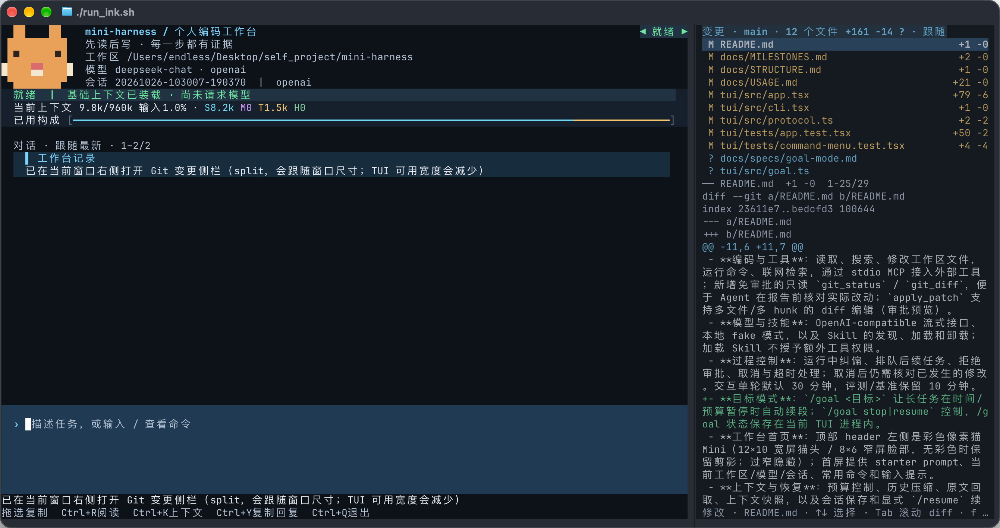
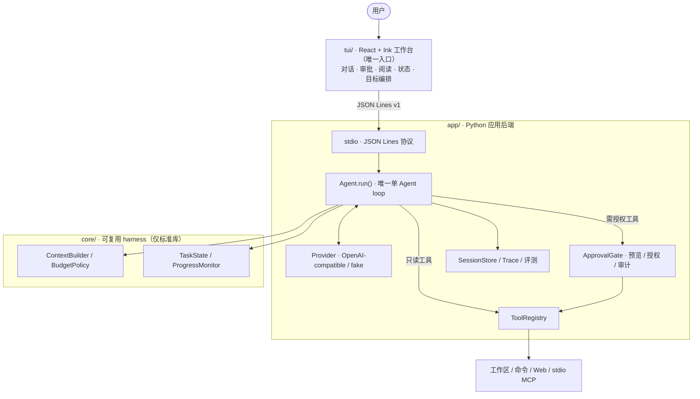

# mini-harness

**个人编码工作台 · 过程可核对、结果可验收的终端 Coding Agent**

以终端为入口的本地编码 Agent：模型负责提议下一步，Python harness 负责组装上下文、审批动作、执行工具，并把过程与结果留成可复查的证据。项目同时作为 Agent 原理与全栈工程的长期学习载体，长期目标是演进为「越用越了解用户」的个人助手工作台。

[](https://www.python.org/)
[](https://www.typescriptlang.org/)
[](https://nodejs.org/)
[](LICENSE)



*React/Ink 工作台（左）与只读 Git 变更侧栏（右）；顶部是产品标识像素猫 Mini。截图为 2026-10-26 的当前版本，点击可查看原图。*

> 状态：单 Agent 编码流程已可用（W1–W5 真实验收完成），持续开发中；最新进度见[工作台里程碑](docs/MILESTONES.md)。

## 项目简介

Agent 执行的步骤一多，最终回答就不足以说明它依据了什么、实际做了什么、验证是否真的通过。这个项目把每次模型请求的上下文构成、每个动作的审批决定、每条命令的退出状态，以及中断后的恢复依据都保存下来，让编码任务可以像 code review 一样被核对。

- **已交付**：单 Agent 编码工作台（工具、审批、上下文、恢复、评测）、长任务 `/goal`、项目背景 `/project` 与个人偏好 `/about`；
- **工程取向**：先把执行边界、证据链和恢复做可靠，再扩展能力；W1–W5 已完成真实验收；
- **边界**：单 Agent loop（Python 单进程执行，无子 Agent；TUI 与只读侧栏为辅助进程）；命令仍以当前用户权限运行，审批 + 黑名单 + 超时是当前边界，可选 macOS Seatbelt 沙箱；
- **自举与学习**：工作台也参与本仓库自身的开发与验收；项目同时用于学习 Agent 原理与 TypeScript / React 全栈和进程间通信。

**技术栈**：Python 3.11+（asyncio、SSE、JSONL、FastMCP、pytest）· TypeScript + React 19 + Ink 8（Node.js 22）· 本地 JSON Lines 协议 · 只读 Git 数据层 · macOS Seatbelt（可选）

## 功能概览

| 方向 | 已交付能力 |
| --- | --- |
| 编码工具 | 读取 / 搜索 / 列目录、`write_file` / `edit_file`、`apply_patch`（多文件多 hunk）、`bash`、免费 Web 搜索、stdio MCP 外部工具；`git_status` / `git_diff` 只读免审批 |
| 技能 | 项目 / 本机 Skill 自动发现；正文按需加载与卸载，加载不授予额外工具权限；`/skills` 菜单支持滚动与 Tab 补全 |
| 执行边界 | 写文件、命令、Web 搜索与 MCP 调用均经 `ApprovalGate` 预览审批（单次 / 精确规则 / 工作区授权，工作区授权仅限内置写入与命令；可撤销、有审计）；无审批处理器时 fail closed；可选 macOS Seatbelt 沙箱与网络白名单 |
| 过程控制 | 运行中纠偏、排队后续任务、取消与超时回收；重复调用 / 重复读取 / 无产物进展的空转护栏；交互单轮默认 30 分钟 |
| 上下文 | 1M 上下文窗口、预算分区、80% 主动压缩、原文 offload + `recall` 回取、请求前上下文快照与 `/context` |
| 会话与恢复 | JSONL 会话与原始消息、崩溃对账、交付回执、显式 `/resume` 续做同一任务 |
| 长任务 | `/goal` 目标模式：资源受限停止后自动续段（默认 8 段 / 4 小时）；目标状态写入会话目录，重启 / `--continue` 后恢复为暂停态，需 `/goal resume` 显式续段 |
| 工作台 | 全屏 Ink、Markdown 阅读、多行输入与历史、拖选复制、Git 变更侧栏、像素猫 Mini 首屏 |
| 个性化 | 项目背景 `/project`（查看、增删、改来源）与个人偏好 `/about`（确认、编辑、触发词、相关性注入、导出/审计）：均带来源，下一次任务生效；W6 v2 未证明收益，保持显式可管理，不扩 P5 |

## 架构



| 层 | 目录 | 职责 | 边界 |
| --- | --- | --- | --- |
| 工作台 | `tui/` | React/Ink 界面、JSONL 协议、Git 侧栏、目标编排 | 主工作台经 JSONL 协议；只读侧栏独立执行固定 git 查询，不持有 Agent 工具执行权 |
| 应用后端 | `app/` | Provider、工具、审批、会话、MCP、评测 | 界面与 eval 共用同一个 `Agent.run()` |
| 可复用 harness | `core/` | 消息、上下文、预算、任务状态、进展检测 | 只依赖标准库，不能 import `app/` 或界面 |

### 设计要点

1. **模型提议动作，harness 决定执行。** 非只读工具先生成预览再过 `ApprovalGate`，授权粒度为单次、精确规则或当前工作区，并支持撤销与审计；没有审批处理器时默认拒绝。命令仍以当前用户权限运行，审批不构成操作系统级沙箱。
2. **上下文按最终请求组装并可核验。** `ContextBuilder` 按预算分区，压缩旧历史时保留可回取的原文；请求前快照统计来源、分区与估算用量，`/context` 可查看变化。展示的是可核对输入，不是对模型行为的解释。
3. **执行结果与恢复状态都是证据。** 命令保留退出码与成功 / 失败 / 超时 / 取消等状态；工具调用按 `run_id + step + tool_call_id` 关联进 trace；交付回执汇总本轮改动、验证命令与未完成项；打开旧会话不自动重放动作，显式 `/resume` 后才继续。
4. **长任务分段落，而不是放宽边界。** `/goal` 只在运行段因资源限制停止时自动续段，遇到无进展、上下文窗口、错误或取消则暂停；每段仍走普通 run 的审批、工具与会话边界。目标状态随会话保存，重启后恢复为暂停态，必须显式续段，避免自动消耗预算。

## 工程验证

结论尽量来自可复核的证据，而不是「看起来能跑」。完整运行记录与验收条件见[工作台里程碑](docs/MILESTONES.md)。

| 验证项 | 方式 | 结果（2026-10-26） |
| --- | --- | --- |
| 自动回归 | `./run_tests.sh`、`npm --prefix tui test` | Python **935** 通过 / 5 项环境跳过（收集 940）；TUI **337** 项中 336 通过（1 项为无 PTY 环境的已知限制） |
| 真实模型任务 | 内部 eval 前 3 题 + SWE-bench Lite 开发集首题 | 内部 eval 前 3 题（创建 / 编辑 / 复制）3/3，其余 7 题未见运行记录；SWE-bench Lite（10 题子集）首题 `pylint-dev__astroid-1196` resolved 1/1（单题，非整榜；前三题扩跑待做） |
| 本地编码基准 | 6 道仓库副本注入 bug 任务（3 道 held-out：2 道保留题 + 1 道跨层压测） | 调优题能力 2/3 → 3/3；保留题 2 题 × 3 次运行 `verified_fix` 全真；跨层压测 3/3 次通过 |
| 端到端里程碑 | 真实模型 + 证据采集脚本 | W1–W5 完成真实验收；W6 v2 三组对照完成（主假设未获支持，如实记录；已停止 P0 扩张，不进入 P5） |
| 评测口径 | 隐藏测试、初始 RED、防改测试；内部 eval 在宿主执行、本地基准用独立临时工作区、SWE-bench 走容器 | 分开记录产物正确 / 运行完成 / 可比较性；支持 `--runs` 多次运行、`--pause-tokens` 暂停续做 |

2026-10-25 按 P0/P1 逐项修复工具工作区边界、流式终止与协议完整性、交付核验、恢复对账、评测有效性与完整 trace 六项缺口，均有针对性回归；真实任务核对使用未参与调优的保留题完成。

## 里程碑与规划

按 W0–W7 推进，以真实任务验收为准；代码完成或自动测试通过不会自动提升状态。

| 里程碑 | 目标 | 状态 |
| --- | --- | --- |
| W0 可复现起点 | 启动、测试与回退基线 | 基线已建；入口 / loop 代码走查与学习记录待补 |
| W1 真实小改动 | 需求 → 修改 → 验证 → 可核对交付 | ✅ 2026-10-23 真实验收 |
| W2 掌控运行 | 运行中纠偏、拒绝、停止与超时 | ✅ 2026-10-23 真实验收 |
| W3 隔天续做 | 中断恢复、副作用对账、压缩后继续 | ✅ 2026-10-23 真实验收 |
| W4 项目背景 | 新任务复用项目事实与决定 | ✅ 2026-10-23 真实验收 |
| W5 关于你 | 个人偏好的查看、确认与纠正 | ✅ 2026-10-24 真实验收 |
| W6 个性化收益 | 对照实验验证是否减少重复说明 | ◐ v2 对照完成，未减少重复说明；停止扩张 |
| W7 第二工作流 | 编码之外的一种常用工作流 | 条件性方向，等待真实需求 |

**下一步**

- **长任务可靠性**：`/goal` 的真实长任务与跨段成本验收。
- **个性化精细化**：W6 v2 未观察到重复说明减少；已停止 P0 扩张、不进入 P5，保留显式偏好管理；后续只有新证据/新评估方法才重新评估。
- **评测扩题**：固定前三题参考补丁自检与 `--limit 3` 扩题，建立多次运行基线。
- **方向探索**：MCP HTTP transport / 资源与 prompt、LSP、多 Agent 主 / 子编排、Computer Use、W7 第二种工作流，按实际需求再评估；两方向调研与规格见 [Multi-Agent 与 Computer Use](docs/specs/multi-agent-computer-use.md)。
- **体验补齐**：Git 侧栏与拖选复制在真实终端中的打开 / 切换 / 授权 / 视觉体验验收。

## 快速开始

依赖：Python 3.11+、`uv`、Node.js 22+。

```bash
uv sync --extra test
npm --prefix tui ci

# 不需要模型 API：启动工作台，检查界面与协议接线
./run_ink.sh --fake
```

配置真实模型（OpenAI-compatible）：

```bash
export VIBE_API_KEY=sk-...
export VIBE_BASE_URL=https://api.deepseek.com/v1
export VIBE_MODEL=deepseek-chat

./run_ink.sh --workspace /path/to/your/repo
./scripts/demo.sh   # 在临时示例仓库体验一次真实编码任务
```

常用验证：

```bash
./run_tests.sh -q           # Python 回归
npm --prefix tui test       # TypeScript / Ink 测试
./run_eval.sh check-budget  # 离线预算机制检查，不需要 API Key
```

安装、模型配置、审批与快捷键见[使用指南](docs/USAGE.md)；演示步骤见[三分钟 Demo](docs/DEMO.md)；评测命令与报告口径见[评测规格](docs/specs/evaluation.md)。

## 文档

| 文档 | 内容 |
| --- | --- |
| [使用指南](docs/USAGE.md) | 安装、模型配置、命令、审批、预算、MCP、侧栏与评测 |
| [工作台里程碑](docs/MILESTONES.md) | W0–W7 的验收条件、真实运行证据与当前状态 |
| [建设方向](docs/roadmap.md) | 长期方向、阶段取舍与界面 / 全栈学习路径 |
| [文件规划](docs/STRUCTURE.md) | 目录职责、依赖方向与新增文件约定 |
| [规格](docs/specs/) | 每个功能切片的 spec、边界与验收口径 |
| [调研](docs/research/) | TUI、评测、沙箱、上下文等选型记录 |

## 使用边界

- 当前是单 Agent、本地单用户；多 Agent 编排与第二种工作流是方向，尚未实现。
- 命令以当前用户权限运行；审批、黑名单、超时与可选 Seatbelt 沙箱不等于容器级隔离。
- fake 模型只证明接线和确定性行为，真实能力以真实模型任务与独立评分为准。
- 个性化收益尚未成立（W6 主假设未获支持），当前只提供可查看、可纠正的偏好管理。

采用 [MIT](LICENSE) 许可证。
