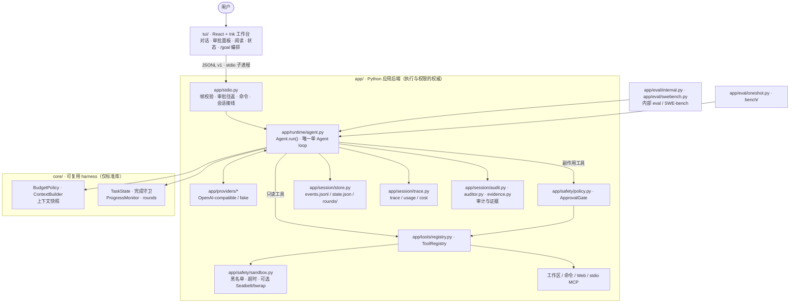
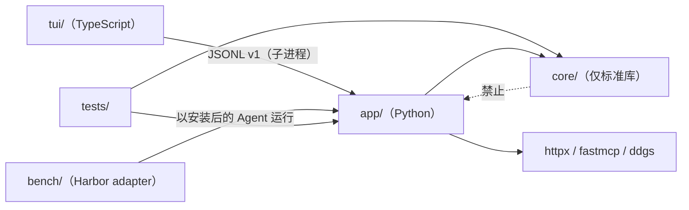
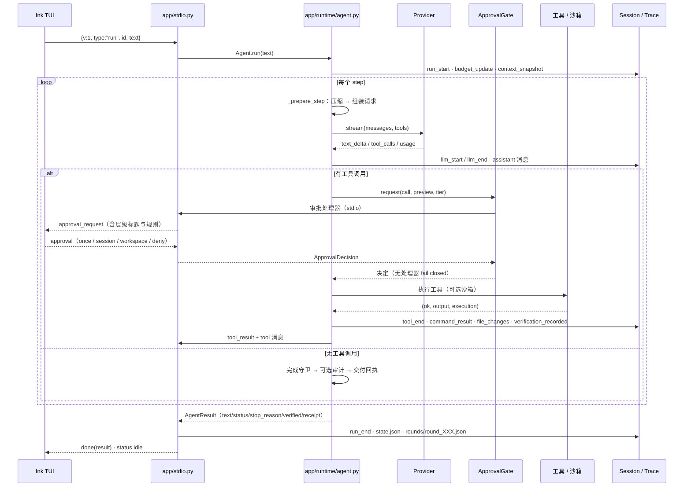

# Harness 技术方案

> 本文描述 mini-harness 中「harness 层」的技术方案：它由哪些部件构成、一次任务如何在其中流转、关键工程决策为什么这样做，以及哪些是已验证的现状、哪些是可选能力或未实现方向。
>
> - **状态**：与 2026-11-03 工作树一致（基于 commit `02a6b6c` + `core/`、`app/` 分域重构）。代码与测试是事实源；本文只做汇总、索引与解释，不替代 `docs/specs/` 里的逐项规格。
> - **范围**：`core/` 与 `app/` 中与 Agent 运行直接相关的部分——模型接入、主循环、上下文、工具、审批与执行边界、任务状态、会话恢复、审计与评测接入。Ink 界面与 Harbor 适配层只在与 harness 交互处提及。
> - **读者**：想理解、核对或改造这套 harness 的工程师与学习者。第一次接触项目建议先看 [README](../README.md) 与 [学习指南](LEARNING.md)。
> - **事实口径**：文中 `path:line` 引用均指向当前工作树；「已实现」「可选」「未实现/推迟」分开标注。涉及运行结果时保留日期，不用一次通过代替能力结论。

## 1 目标、边界与设计原则

### 1.1 要解决的问题

Agent 执行的步骤一多，最终回答就不足以说明它依据了什么、实际做了什么、验证是否真的通过。这个项目把失败归纳成三类，并让 harness 分别承担对应责任：

| 失败模式 | 具体表现 | harness 的应对 |
|---|---|---|
| 过程不可核对 | 模型说“已修改/已通过”，但没有任何可复查的记录 | 工具结果保留退出码与状态；动作关联 `run_id + step + tool_call_id`；每轮落盘不可变轮次账本（§7.6、§10） |
| 边界靠模型自觉 | 模型可以直接写文件、执行命令、访问网络 | 非只读动作必须经过 `ApprovalGate`；无审批处理器时 fail closed；可选 OS 沙箱兜底（§6） |
| 上下文与状态混在一起 | 长任务里历史越堆越长，任务状态和执行轨迹互相挤占 | 预算分区 + 压缩/offload/recall；状态是 harness 侧的外部记录，不依赖模型记忆（§4、§7、§8） |

因此本项目的定位不是“让模型更聪明”，而是**把模型放进一个可解释、可验证、可恢复的执行框架**。模型负责提议下一步，harness 负责决定请求什么、能不能执行、何时停下、结果算不算证据。

### 1.2 本文所说的 harness 边界

项目里 “harness” 一词同时指整个项目名、`core/` 包和“Python 运行层”。本文统一如下：

| 层 | 目录 | 在本文中的角色 |
|---|---|---|
| 可复用 harness | `core/` | 消息、预算、上下文、任务状态、进展检测、轮次记录；**只依赖标准库** |
| 应用后端 / 运行层 | `app/` | 唯一 Agent loop、Provider、工具、审批、沙箱、会话、审计、评测入口 |
| 工作台界面 | `tui/` | 唯一交互入口（React + Ink），通过 JSONL v1 与 `app/stdio.py` 通信；不持有执行与审批权 |
| 跑分适配 | `bench/` | Harbor 适配层，把 `app` 装进任务容器；不是 `app` 的依赖 |

**不在本文范围**：Ink 组件的渲染细节、Ghostty 侧栏集成、Harbor 评测协议本身、各 `docs/specs/` 里已有完整论证的单点行为。相关入口已在附录 C 列出。

### 1.3 设计原则

1. **模型提议动作，harness 决定执行。** 读写工具、命令、Web 搜索、MCP 调用都经 `ToolRegistry`；非只读动作先生成预览再过 [`ApprovalGate`](../app/safety/policy.py)，授权粒度为单次 / 精确规则 / 当前工作区，可撤销、有审计；没有审批处理器时默认拒绝（`app/safety/policy.py:159-161`）。审批不构成操作系统级沙箱，这一区分在 §6 与 §12 明确写出。
2. **上下文按最终请求组装，并可核对。** `ContextBuilder` 按预算分区压缩、优先 offload 原文；请求前生成上下文快照（来源、分区、估算用量、块级 hash），`/context` 可查看快照与压缩变化。展示的是**可核对的输入**，不是对模型行为的解释（§4.5）。
3. **执行结果与恢复状态都是证据。** 命令保留退出码与成功/失败/超时/取消状态；工具调用按 `run_id + step + tool_call_id` 关联进 trace；每轮写入轮次账本（文件变动前后 hash、验证记录、审计结论、交付回执）；打开旧会话不自动重放动作，显式 `/resume` 后才继续（§7、§8）。
4. **长任务分段落，而不是放宽边界。** `/goal` 只在运行段因**资源限制**停止时自动续段；遇到无进展、上下文窗口、错误或取消则暂停。每段仍走普通 run 的审批、工具与会话边界；重启后目标恢复为暂停态，必须显式续段，避免自动消耗预算（§8.5）。
5. **确定性优先，真实能力单独验收。** 单元测试与 fake provider 证明接线与契约；真实模型任务、内部 eval、本地基准、SWE-bench/Harbor 分别记录，不用离线机制通过替代真实任务验收（§9）。

### 1.4 硬约束与不变量

这些是跨模块的“合同”，改动时需要确认没有被破坏：

- **单 Agent、单进程 loop**：唯一执行循环是 [`Agent.run()`](../app/runtime/agent.py)，stdio 后端与 eval 共用它；TUI 与只读侧栏是辅助进程，不持有工具执行权（`docs/STRUCTURE.md:196-228`）。
- **`core/` 只依赖标准库**：不能 import `app/`、`httpx`、`rich`；由 [`tests/test_core_dependencies.py`](../tests/test_core_dependencies.py) 与 [`tests/test_core_layout.py`](../tests/test_core_layout.py) 兜底（`AGENTS.md:16`）。
- **副作用一律过审批闸**：写文件、命令、网络、MCP 调用都先过 `ApprovalGate`；无 handler 时 `deny`，未知风险按最保守层级处理（`app/safety/permissions.py:37-39`、`app/safety/policy.py:159-161`）。
- **工具调用必须配对**：assistant 的每个 `tool_call` 都必须有对应 `role=tool` 结果；未执行的调用补 `ERROR not_executed: <reason>`，绝不静默丢弃（`app/runtime/agent.py:91-111,1758-1767`）。
- **会话 append-only**：事件只追加；恢复不重放动作，崩溃后不能假装工具成功（`app/session/store.py:392-420`）。
- **完成判定只依据 harness 观测到的事实**：模型自述、`update_task` 状态都不参与 `verified` 判定（`core/task/state.py:53-86`）。
- **压缩不静默丢内容**：每个被移除的组必须在 `notes` 里有 offload ref、summary 或 dropped 记录（`core/context/builder.py:341-382`）。
- **运行时产物只写 `.vibe/`**：offload、会话、备份、评测产物均在此目录，仓库不提交（`.gitignore:1`、`AGENTS.md:18`）。

## 2 总体架构

### 2.1 分层与进程模型



两个边界值得强调：

- **界面与执行分离**：TUI 只发请求、收事件、做审批回传；界面断开不能被当作批准，工具执行与审批决定始终由 Python 持有（`docs/roadmap.md:19-21`）。
- **可复用层与消费方分离**：`core/` 不认识界面、网络与具体工具；`app/` 是第一个 consumer；任何“core 需要界面”的需求都意味着分层错了（`docs/STRUCTURE.md:196-228`）。

### 2.2 模块地图

| 分组 | 主要文件 | 职责 |
|---|---|---|
| 消息与事件 | `core/contracts/messages.py`、`app/events.py` | `Message` / `ToolCall` / `Response` / `ExecutionOutcome`；Provider 事件联合类型 |
| 预算与上下文 | `core/budget/policy.py`、`core/context/builder.py`、`core/context/snapshot.py`、`core/context/summarize.py`、`app/runtime/summarize.py` | S/M/T/H/R 分区、压缩与 offload/recall、请求前快照、确定性/LLM 摘要 |
| 执行引擎 | `app/runtime/agent.py` | 唯一 loop：步前准备、模型请求、回复解释、工具执行、终止与完成判定 |
| 模型接入 | `app/providers/{base,fake,openai_compat}.py`、`app/config.py` | Provider 协议；SSE `/chat/completions`；脚本化 fake；env 配置 |
| 工具 | `app/tools/registry.py`、`app/tools/patch.py`、`app/tools/mcp.py`、`app/tools/skills.py`、`app/tools/diff.py` | 工具注册与执行、apply_patch、stdio MCP、技能生命周期、diff 预览 |
| 执行边界 | `app/safety/policy.py`、`app/safety/permissions.py`、`app/safety/permission_policy.py`、`app/safety/sandbox.py`、`app/safety/sandbox_proxy.py` | 审批闸、T0–T4 层级与作用域、用户/项目策略、命令边界与可选 OS 沙箱 |
| 状态与证据 | `core/task/state.py`、`core/task/progress.py`、`core/task/rounds.py`、`app/session/audit.py`、`app/session/auditor.py`、`app/session/evidence.py`、`app/session/trace.py` | 任务状态、完成守卫、进展检测、轮次账本、环境审计、可选 LLM 审计、证据摘要 |
| 持久化与协议 | `app/session/store.py`、`app/stdio.py` | JSONL 会话与恢复、崩溃对账、JSONL v1 后端协议 |
| 评测 | `app/eval/internal.py`、`app/eval/swebench.py`、`app/eval/container.py`、`app/eval/data.py`、`app/eval/oneshot.py`、`app/eval/budget_checks.py`、`bench/` | 内部 eval、SWE-bench Lite、Harbor 接入、非交互跑分、离线预算检查 |
| 个性化 | `app/profiles/instructions.py`、`app/profiles/project.py`、`app/profiles/user.py`、`app/tools/skill_history.py` | `AGENTS.md` 注入、项目背景、个人偏好、技能历史视图 |
| 界面与辅助进程 | `tui/src/*`、`tui/src/sidebar/*` | 工作台、JSONL 客户端、只读 Git 侧栏 |
| 测试 | `tests/*`、`tui/tests/*` | Python 契约回归；Node/Ink 协议与渲染测试 |

`core/` 内部进一步按 `contracts / budget / context / task` 四个域组织，依赖单向；落位规则、未来模块位置与布局测试见 [core/README.md](../core/README.md)；`app/` 内部按 `runtime / tools / safety / session / profiles / browser / eval` 分域，入口保留 `__main__.py` / `stdio.py`，规则见 [app/README.md](../app/README.md)。

### 2.3 依赖方向与硬规则



- `core/` 是“可复用 harness”，不是“内部实现细节集合”：它只包含与界面、网络、具体工具无关的通用部件，这样才可能被第二个项目复用；内部按 `contracts / budget / context / task` 分域，规则见 [core/README.md](../core/README.md)。
- `app/` 负责模型接入和所有副作用，内部按域组织（`runtime/tools/safety/session/profiles/browser/eval`，见 [app/README.md](../app/README.md)）；`bench/` 是独立适配层，运行 `app` 但不被 `app` import。
- 测试与模块一一对应（`tests/test_<module>.py`），新模块至少覆盖成功路径 + 一个失败路径（`docs/STRUCTURE.md:252`）。

### 2.4 一次任务的数据流



按时间顺序，一次任务的 13 个环节与对应记录如下（完整清单见 `.vibe` 之外的 trace 与 events；实现位置见括号）：

| # | 环节 | 写入的事件/消息 | 实现 |
|---|---|---|---|
| 1 | 界面提交 | `{v:1,type:"run",id,text}` 帧 | `tui/src/backend.ts` |
| 2 | 协议入口 | 校验 `v=1`、id、字段白名单、单帧 ≤1 MiB；忙则 `error busy`；建 cancel Event | `app/stdio.py:571-642` |
| 3 | run 准备 | 重载权限策略、刷新技能、装载背景、`run_start` / `budget_update` trace | `app/runtime/agent.py:564-665` |
| 4 | 步前准备 | 消费纠偏、刷新 system 与 task_state、必要时压缩、`context_snapshot(request)` | `app/runtime/agent.py:687-822,1607-1641` |
| 5 | 模型流 | `llm_start` → `text_delta` 帧 → `llm_end`（usage/cost），重试有独立 request_id | `app/runtime/agent.py:824-1011`；`app/session/trace.py:49-100` |
| 6 | 回复解释 | assistant 消息写 `events.jsonl`；截断续写/空回复/action_required 分支 | `app/runtime/agent.py:1013-1115` |
| 7 | 工具审批 | `tool_start`；`approval_request` / `approval_resolved`；审批等待不计运行时长 | `app/runtime/agent.py:1239-1300,1867-1892` |
| 8 | 工具执行 | `command_result`（status/exit_code）、`file_changes`、`verification_recorded`、`tool_end` | `app/runtime/agent.py:1297-1354` |
| 9 | 结果回灌 | `role=tool` 消息 + `tool_result` 帧；`state.json` 更新；必要时 `no_progress` | `app/runtime/agent.py:1359-1423` |
| 10 | 下一 step | 回到第 4 步；压缩后 history 通过 `context_checkpoint` 落盘 | `app/runtime/agent.py:667-685`；`app/session/store.py:270-280` |
| 11 | 完成/停止 | 完成守卫（`completion_rejected` / `completion_audit`）→ `_finish` → `run_end` → 轮次记录 | `app/runtime/agent.py:1117-1237,1505-1573` |
| 12 | 收尾写盘 | 保存 context/state；`metrics` 刷新；发 `done(result)` 与 `status idle` | `app/stdio.py:527-569` |
| 13 | 会话留痕 | `events.jsonl`、`state.json`、`context_checkpoint`、`trace.jsonl`、`rounds/`、`audit.jsonl` | `app/session/store.py:24-56,180-201,342-371` |

### 2.5 技术选型

| 选型 | 事实 | 理由/边界 |
|---|---|---|
| Python 3.11+，asyncio | 唯一 loop 与流式、工具、审批都是 async；`asyncio.to_thread` 只用于同步阻塞工作（上下文构建、快照） | 与模型 SDK 解耦，HTTP/流式自己控制 |
| httpx + SSE | `AsyncClient.stream` 逐行解析 `data:`；工具参数按 index 累积；`stream_options.include_usage` 取真实 usage | 不引入厂商 SDK；任意 OpenAI-compatible 端点可用 |
| 本地 JSONL v1 | TUI ↔ Python 单连接、行分隔 JSON、`v:1/type/id`、单帧 ≤1 MiB、单活跃 run | 进程边界清晰、可调试；Python 持有执行权 |
| React 19 + Ink 8 + Node 22 | 工作台是 TypeScript 项目，锁 `tui/package-lock.json` | 服务长期全栈学习目标；界面可替换 |
| FastMCP（stdio） | 外部工具以 MCP server 接入，启动与每次调用分别审批 | 扩展能力不进入核心工具表；HTTP transport 未实现 |
| fake provider | 脚本化响应并记录每次 `seen` messages/tools | 单测、`--fake` 冒烟、离线预算检查的确定性基础 |
| pytest / Node test | Python `tests/` 镜像模块；TUI 编译后用 `node --test` | 每层只证明它该证明的（§9.1） |
| 可选 OS 沙箱 | macOS Seatbelt / Linux bwrap；默认关闭，网络默认拒绝，白名单走本地代理 | 不是容器级隔离；Docker 只用于 SWE-bench 评测 |
| SWE-bench / Harbor（可选依赖） | `swebench==4.1.0` 只在 `eval` extra；Harbor 是外部 `harbor run`，不是运行依赖 | 避免把评测依赖带入日常运行 |

## 3 执行引擎：单 Agent 主循环

一句话：模型提议下一步，Python 主循环决定请求什么、能不能执行、何时结束。一次 run = 一次 `Agent.run()`；主循环只表达“准备 → 模型 → 判断 → 工具”。

### 3.1 循环形态与阶段划分

循环体只有 5 行语义（`app/runtime/agent.py:667-685`）：

```python
for step in count(1):
    plan = await self._prepare_step(run, step)      # → _StepPlan | AgentResult
    turn = await self._call_model(run, step, plan)  # → _ModelTurn | AgentResult
    decision = await self._decide_after_model(...)  # → _StepDecision | AgentResult
    if decision.calls:
        stopped = await self._run_tool_calls(...)   # → AgentResult | None
```

“返回 `AgentResult` 就是退出”是唯一控制流约定，不再用 `done` 标志；`for step in count(1)` 与 `while True` 等价（[loop 拆分记录](specs/agent-loop-refactor.md)）。

| # | 阶段 | 输入 → 输出 | 关键行为 | 位置 |
|---|---|---|---|---|
| 0 | run 准备 `_run` | task/history → `_RunContext` | 重载策略、刷新技能、建/续 TaskState、记本轮证据起点、构造进度监控、绑定 steer 队列；`finally` 写回配对后的 history | `app/runtime/agent.py:564-665` |
| 1 | 步前准备 `_prepare_step` | (`_RunContext`, step) → `_StepPlan` | 取消/步数检查 → 消费 steer → 刷新 system 与 task_state → 压缩 → 组装请求 → 收尾/窗口检查 | `app/runtime/agent.py:687-822` |
| 2 | 模型请求 `_call_model` | plan → `_ModelTurn` | 时间/取消检查、请求快照、调用流、重试、usage 估算与记账 | `app/runtime/agent.py:824-938` |
| 3 | 单次流 `_stream_once` | plan + request_id + timeout → `_StreamCapture` | 采集事件；timeout 与 cancel 竞速，只返回手头结果 | `app/runtime/agent.py:940-1011` |
| 4 | 回复解释 `_decide_after_model` | `_ModelTurn` → `_StepDecision`/`AgentResult` | 错误、文本工具协议、id 补齐、消息记录、截断续写、空回复、`require_tool_use`、完成判定 | `app/runtime/agent.py:1013-1115` |
| 5 | 工具执行 `_run_tool_calls` | calls → `AgentResult`/None | 审批 → 执行 → 回灌 tool 消息 → 记录文件/验证证据 → 进展检测 | `app/runtime/agent.py:1239-1424` |
| 6 | 收尾 | 完成文本 → `AgentResult` | 完成守卫 + 可选审计 → 回执 → trace `run_end` → 轮次记录 | `app/runtime/agent.py:1117-1237,1505-1573` |

阶段交接用四个只存在于一次 run 内的类型：`_RunContext`（run 作用域状态，见 §3.2）、`_StepPlan`（本步请求与收尾标记）、`_ModelTurn`（模型回复）、`_StepDecision`（继续下一步或执行这批工具）。四个终止出口最终都落到 `_finish`：

| 出口 | 何时用 | 做了什么 |
|---|---|---|
| `_finish` | 正常完成、错误、截断、取消兜底 | `recorder.end` → usage → 交付回执 → `AgentResult` → `on_round` 轮次记录（`app/runtime/agent.py:1505-1573`） |
| `_pause_budget` | 累计 token/费用/收尾预算不足 | 补齐未执行工具 → 必要时先压缩 → 生成 budget_stop 说明 → `stopped`（`app/runtime/agent.py:1714-1756`） |
| `_pause_progress` | 无进展/无产物进展判停、无工具收尾失败 | `_skip_tools` 补齐 → 生成 progress_stop 说明 → `stopped/no_progress`（`app/runtime/agent.py:1769-1788`） |
| `_cancel_pending` | 取消时还有未执行调用 | 补 `ERROR cancelled: not executed` → `cancelled`（`app/runtime/agent.py:1894-1904`） |

`_skip_tools` 是所有“本批次剩余调用不执行”路径的统一配对器：`ERROR not_executed: <reason>` + `tool_not_executed` trace（`app/runtime/agent.py:1758-1767`）。调用点包括截断、chat-only、时间上限、无进展、预算暂停。

### 3.2 run 作用域状态与阶段交接

`_RunContext`（`app/runtime/agent.py:130-183`）就是“这次 run 的工作台”。它不跨 run 复用，字段可按职责分组理解：

| 组 | 字段 | 用途 |
|---|---|---|
| 外部接线 | `cancel`、各 `on_*` 回调、`trace` | 由 stdio/eval 注入；主循环只回调，不关心界面 |
| 权威状态 | `state`、`state_message`、`messages`（请求视图）、`raw_history`（未压缩权威历史）、`recorder` | `_record_message` 同时写 messages 与 raw_history；`_compact` 重建两者 |
| 预算/账本 | `previous_prompt_tokens`、`previous_completion_tokens`、`history_compacted`、`compacted_at_tokens`、`high_water_suppressed` | 估算真实比例、压缩周期基线、避免高位反复压缩 |
| 快照 | `snapshot_sequence`、`previous_snapshot` | 为每次快照生成 id 与 delta |
| 步/尝试 | `current_step`、`current_attempt` | `request_id = run_id:step:attempt` |
| 护栏 | `progress`、`artifact_progress`、`task_kind`、`progress_stop`、`correction_instruction`、`pending_steering`、`denied_requests` | 见 §3.6 |
| 恢复/完成 | `empty_retries`、`action_required_sent`、`continuations`、`completion`、`audit`、`verified`、`completion_rejections` | 空回复/续写/完成守卫状态 |
| 证据起点 | `start_mutation_seq`、`start_file_changes`、`start_verifications`、`start_files_changed`、`start_command_results`、`started`、`approval_wait_seconds`、`baseline` | 让本轮回执/verified 只统计本轮增量；运行时长扣除审批等待 |

原则：阶段函数只通过 `run` 读改状态；进入下一阶段前，旧阶段结果已落到 `run` 或返回类型里。

### 3.3 模型接入与流式响应

| 层 | 事实 |
|---|---|
| 协议 | `Provider.stream(messages, tools)` 异步产出事件；`Agent` 不感知 HTTP（`app/providers/base.py:9-14`） |
| 事件 | `TextDelta`、`ReasoningDelta`、`ToolCallsReady(calls, incomplete)`、`StreamDone(finish_reason, usage, reasoning_content)`、`StreamError(message, retryable)`（`app/events.py:8-34`） |
| OpenAI 兼容 | httpx `AsyncClient.stream` + 逐行 `data:` SSE；`tool_calls` 按 index 累积分片；`stream_options.include_usage` 取 usage；`[DONE]`/finish_reason 都缺则 finish_reason 记为 truncated（`app/providers/openai_compat.py:86-205`） |
| 错误与重试 | 400+ 返回 `StreamError`；408/409/429/5xx retryable；仅“可重试 + 无半截输出 + 次数未到 + 非收尾 + 未取消”才重试，退避 0.5×attempt，重试前做累计预算预检（`app/providers/openai_compat.py:120-127,169-171`；`app/runtime/agent.py:906-929`） |
| 超时 | `min(llm_timeout, 剩余运行时间)`；超时保留已收内容并标记 error（`app/runtime/agent.py:859,1008-1010`） |
| 不完整调用 | name 或 JSON 参数没解析全 → 只进 `incomplete`，agent 侧补 `not_executed`（`app/providers/openai_compat.py:192-198`；`app/runtime/agent.py:1050-1051`） |
| usage | 供应商 usage 优先；缺失时 prompt 用请求估算、completion 用输出文本估算，并在 trace 标 `estimated`（`app/runtime/agent.py:877-905`） |
| fake | 脚本化确定性 provider：字符串按 8 字符切片，`Response` 可带 `tool_calls`，脚本耗尽输出 `[fake provider exhausted]`，并记录每次 `seen` messages/tools（`app/providers/fake.py:10-43`） |

`--fake` / `VIBE_PROVIDER=fake` 选择 `FakeProvider`，无 key；`VIBE_FAKE_DEMO=1` 走“写文件 → 审批 → 验证”的确定性演示。fake 的用途是验证接线与契约，不是能力证明（`app/__main__.py:25-66`；`README.md:189`）。

### 3.4 工具调用执行与消息配对

1. 模型回复先记为一条 assistant 消息（text + calls + incomplete + reasoning），然后才执行工具（`app/runtime/agent.py:1045-1049`）。
2. 未执行/被跳过的调用一律补 `role=tool` 消息，`tool_call_id` 与 assistant 的 call id 对齐，保证下一请求协议合法（`app/runtime/agent.py:91-111,1758-1767`）。
3. `tool_call_id` 是关联主键：`assistant.tool_calls[i].id ↔ tool.tool_call_id`；缺 id 时按 `step{n}_call{i}` 补（`app/runtime/agent.py:1042-1044`）。
4. 文本工具协议（部分模型）：无原生 calls 时解析 `<tool_call>{...}</tool_call>`；chat-only 模式下出现则 error（`app/runtime/agent.py:41-60,1032-1040`）。
5. 截断：`finish_reason` 为 `length/truncated` 且无 calls → 追加“Continue exactly from where you stopped”的 user 消息，最多 `max_continuations`；有 calls 则全部 skip 并 `error: truncated tool call`（`app/runtime/agent.py:1062-1082`）。
6. 空回复：第 1 次继续，第 2 次 `error: empty model response`（`app/runtime/agent.py:1084-1089`）。
7. `require_tool_use`：动作任务零工具调用时注入 `action_required` 系统消息并继续；再次仍不动则 `stopped/no_action`（`app/runtime/agent.py:1090-1104`）。chat-only 模式请求工具直接 error。
8. 恢复：`Agent.__init__` 采纳历史时做 `ensure_tool_pairing`；打开旧会话时 session 先补 `ERROR interrupted`（§8.2）。

### 3.5 终止路径与停止原因

`AgentResult`（`app/runtime/agent.py:114-127`）字段：`text`、`steps`、`status`、`usage`、`cost_usd`、`run_id`、`stop_reason`、`error`、`receipt`（交付回执）、`verified`、`completion`（完成守卫结论）、`audit`（环境/LLM 审计）。

| status | stop_reason | 触发 | 退出时 steps |
|---|---|---|---|
| `done` | 空 | 模型不再调用工具且完成守卫通过/不适用 | 当前 step |
| `stopped` | `max_steps` | `max_steps > 0` 且 step 超限 | step-1（已判定无进展时走 no_progress 出口） |
| `stopped` | `max_run_seconds` | 活跃运行时间耗尽（请求前、请求中、工具循环） | step-1 或 step |
| `stopped` | `context_window` | 请求装不进单请求输入容量 | step-1 |
| `stopped` | `token_budget` / `cost_budget` | 累计 token / 费用预算不足 | step |
| `stopped` | `no_progress` / `no_action` | 进展检测判停 / `require_tool_use` 二次仍无动作 | step |
| `cancelled` | `cancelled` | cancel Event 触发 | step（或 step-1） |
| `error` | 空 | 模型错误、空回复、chat-only 请求工具 | step（或 step-1） |
| `truncated` | 空 | 续写次数耗尽或截断工具调用 | step |

步骤口径：请求前停止报“已完成步数”，模型之后停止报当前 step（`app/runtime/agent.py:690,1026`）。回执由 `delivery_receipt` 生成，把“运行结束”与“任务验收”分开陈述（§8.4）。`_finish` 同时触发 `on_round` 写不可变轮次记录（§7.6）。注意 `status` 实际还有 `truncated`（`app/runtime/agent.py:1065-1067,1082`），而 `AgentResult.status` 的注释只列了 done/stopped/cancelled/error——以代码为准。

### 3.6 运行中护栏

| 护栏 | 默认/开关 | 行为 | 位置 |
|---|---|---|---|
| 步数 | `max_steps=0` 不限 | 只有显式 >0 才检查 | `app/runtime/agent.py:691` |
| 运行时长 | 交互 1800s；`Agent` 默认 600s；eval 120s；bench 600s | 到点停止；审批等待不计入 | `app/config.py:23`；`app/runtime/agent.py:1864-1865` |
| 累计 token | `max_run_tokens=0` 不限（交互） | 到量前先生成 checkpoint，再暂停 | `app/runtime/agent.py:780-786,1714-1756` |
| 费用 | `max_run_cost_usd=0` 不限 | 超限记 `cost_budget` | `app/runtime/agent.py:1020-1022` |
| 周期压缩 | `compact_interval_tokens=200k` | 距上次压缩累计消耗 ≥80% 触发（§4.6） | `app/runtime/agent.py:721-728` |
| 重复调用 | 同参数累计 6 次 | `repeated_call` 纠偏；批次内重复直接 skip | `core/task/progress.py:112-114`；`app/runtime/agent.py:1259-1268` |
| 重复读取 | 同文件 5 次（两次写之间） | `repeated_read` 纠偏 | `core/task/progress.py:117-123` |
| 重复结果 | 同参同输出 | `repeated_result` 停滞计数 | `core/task/progress.py:124-125` |
| 仅更新计划 | `update_task` | 不算证据，`state_only` | `core/task/progress.py:115-116` |
| 无产物进展 | 动作任务 20 次无变化 | 先 warn 后 stop（no_progress 收尾） | `core/task/progress.py:26-63`；`app/runtime/agent.py:1374-1400` |
| 停滞预算 | 警告 4 次 | 累计警告后直接 stop | `core/task/progress.py:141-153` |
| steer | 运行中提交 | 下一步写成真实 user 消息 + constraint；收尾前也先消费 | `app/runtime/agent.py:530-536,1582-1592` |
| 取消 | cancel Event | 中断模型/工具/审批；未执行调用补 cancelled；不回滚已发生副作用 | `app/runtime/agent.py:1894-1904`；`docs/USAGE.md:95` |
| 空转提示回灌 | `correction_instruction` | 下一步以追加 system 消息注入，用完清空 | `app/runtime/agent.py:746-749,806` |

## 4 上下文工程

目标：每次请求的上下文都可解释、可回取、可核对；压缩不是“截断后祈祷”，而是 offload → 摘要 → drop 且有笔记。

### 4.1 预算分区（S/M/T/H/R）

代码里的六个字段对应 **S**ystem / **M**emory / **T**ools / **H**istory / **R**esponse(output)，另有独立的 **scratch** 安全余量（`core/budget/policy.py:10-16`）。字母简称来自文档，代码以字段名为准。

| 分区 | 字段 | 默认 cap（1M 窗口） | 公式/语义 |
|---|---|---|---|
| S 系统 | `system_cap` | 8,000 | 基础指令 + 项目规则 + 用户/项目背景 + 技能入口/正文 |
| M 记忆 | `memory_cap` | 64,000 | 预留长期资料；当前实际传 0（`app/runtime/agent.py:739`） |
| T 工具 | `tools_cap` | 16,000 | 只算工具**定义**；工具结果算 history |
| H 历史 | `history_cap=None` | 名义 872,000 | `window − S − M − T − R − scratch`；实际额度见下 |
| R 输出 | `output_cap` | 32,000 | 输出预留；`prompt_cap = window − R = 968,000` |
| scratch | `scratch_cap` | 8,000 | 安全余量，从 history 额度再扣一次 |
| unallocated | — | 0 | `window − 已预留 − history` |

- **1M 从哪来**：`BudgetPolicy.context_window = 1_000_000` 是代码默认（`core/budget/policy.py:10`），`Config.context_window` 默认取它，可用 `VIBE_CONTEXT_WINDOW` 或旧名 `VIBE_MAX_TOKENS` 覆盖（`app/config.py:38,98-100`）。
- **小窗口如何缩放**：`for_context_window` 用 `min(window, 1M)` 把默认预留按比例缩放；预留总和超过窗口时再按比例收缩；显式 `history_cap` 被钳到剩余容量（`core/budget/policy.py:43-57`）；测试覆盖 0/1k/80k/128k/1M/2M（`tests/test_budget.py:48-61`）。
- **history 有效额度**：`history_budget(system, memory, tool) = prompt_cap − 实际 S − 实际 M − 实际 T − scratch`，再受显式 `history_cap` 限制；默认可到约 960k（`core/budget/policy.py:93-105`）。
- **为什么不是按比例等分**：项目选择“绝对上限 + 剩余给 history”，而不是 10% system=100k 之类，避免窗口放大后 system/tools 抢占过多（`docs/RETRO.md:67`）。

### 4.2 压缩管线

两个入口，共用一套分组/预算原语：

| 入口 | 何时用 | 摘要器 | 位置 |
|---|---|---|---|
| `ContextBuilder.build` | 每步组装实际请求；超预算时内部修剪 | 注入的 `summarizer`（窗口压缩路径可为 LLM 摘要） | `core/context/builder.py:387-456` |
| `ContextBuilder.compact_history` | Agent 主动压缩（80%/预算/收尾） | 调用方显式传入（Agent 传确定性摘要） | `core/context/builder.py:125-257`；`app/runtime/agent.py:1684-1688` |

管线（`core/context/builder.py:125-257,320-385`）：

1. 拆出 system 与 history；钉住首个 user 与最新 user（最新 user 所在组强制进 recent）（`core/context/builder.py:136-155`）。
2. 分组：`assistant(tool_calls)` + 紧随的 tool 结果为一组，不拆（`core/context/builder.py:63-78`）。
3. 保留最近 `keep_recent_groups` 组；超出预算时从旧到新把组移出 recent，并记录 `recent_window_reduced`（`core/context/builder.py:150-196`）。
4. 主动路径写盘顺序：先把旧历史整体 offload 成归档 → 再按 ≤8 组 / 约 8k tokens 产 L1 摘要 → L2 汇总；原文 ref 放 L2 页脚（`core/context/builder.py:242-303`）。
5. `build` 路径顺序：offload 含 tool 的旧组 → offload 其他旧组 → 合成为 `[summary]` → 仍超就 drop 最旧组；每步记 `notes`（`offloaded:tool:` / `offloaded:group:` / `summarized` / `dropped:`）（`core/context/builder.py:341-382`）。
6. 产出 `ContextResult(messages, tokens, offloaded, summarized, over_budget, notes, sections, caps)`（`core/context/builder.py:51-60`）。
7. 失败契约：pinned 超预算 → 原样返回并标 `over_budget`；offload 不可用/失败 → 保持当前消息并记 notes；摘要异常 → 确定性回退；循环有 100 次 guard（`core/context/builder.py:178-180,214-225,230-240,366-370`）。

`stable_prefix_hash` 是“system 前缀指纹”（排除 `task_state`），当前只在测试中使用，**未接入**请求前缀复用/缓存，不要把写作已实现能力（`core/context/builder.py:42-48`）。

### 4.3 原文 offload 与 recall

- 目录：`.vibe/offload/`；文件名 `off-<sha256(payload)[:8]>.json`，内容是消息 `asdict` 列表（`core/context/builder.py:502-514`）。
- ref 形如 `off-1a2b3c4d`，上下文里以 `[offloaded: ref]` 出现（`core/context/builder.py:17,505`）。
- `resolve(ref)`：先查内存缓存，再校验 ref 正则、目录边界、2 MiB 上限后从磁盘读；`message_from_dict` 做结构校验；归档引用可嵌套展开，限 256 层（`core/context/builder.py:458-491`）。
- 跨 builder 可读：ref 只含内容 hash，解析只依赖 `offload_dir` 里的文件，与创建它的 builder 实例无关（[历史压缩规格](specs/history-compression.md)）。
- 模型入口 `recall(ref)`：把原文按角色重排，单条 8k、总 20k 截断；未知 ref → ValueError（`app/tools/registry.py:821-836`）。只有挂了 `ContextBuilder` 才注册该工具。

### 4.4 摘要机制

| 实现 | 性质 | 输入/输出 | 失败行为 | 位置 |
|---|---|---|---|---|
| `core.summarize.summarize_messages` | 确定性、纯标准库 | 逐条角色 + 内容前 300 字/工具调用；总 4000 字符，头尾截断 | 不失败 | `core/context/summarize.py:6-29` |
| `app.runtime.summarize.LLMSummarizer` | 同步 HTTP，非流式，独立 60s 超时 | transcript（≤60k）→ `max_tokens=800` → 截到 `max_chars` | 任何异常返回确定性摘要并记 `last_error` | `app/runtime/summarize.py:17-91` |

注入与使用边界（容易误读）：真实 provider 才注入 `LLMSummarizer`，fake 直接注入确定性摘要（`app/__main__.py:218-233`）；`build` 内的 summary 走注入的 summarizer；Agent 主动压缩时显式传 `summarize_messages`，因此主动 L1/L2 摘要不额外调模型；LLM 摘要的 token 消耗不经过 `TraceRecorder` 计量（`docs/specs/history-compression.md:35,42`）。

### 4.5 请求前快照与可核对性

- 纯函数 `build_context_snapshot(messages, tool_specs, policy|legacy, system_parts)`：只输出计数、身份和来源，不存正文（`core/context/snapshot.py:43-166`）。
- 固定字段：`schema_version=1`、`estimated=true`、`count_method=heuristic_cjk_v1`、`context_window`、`input_capacity`、`total_tokens`、`sections{system,memory,tools,history}`、`caps`（含 `history_nominal` 与有效 `history`）、`reserves{output,scratch}`、`remaining_tokens`、`over_budget`、`blocks`。
- block 记 `id`（内容/来源 hash 去重后加序号）、`section`、`kind`（system 片段、user、assistant、tool_result、tool_call、history_summary、offload_reference、reasoning、tool_definition）、`label`、`source`、`tokens`、`chars`、`content_hash`（`core/context/snapshot.py:57-133`）。
- Agent 侧 `_context_snapshot` 附加 `snapshot_id` / `request_id` / `step` / `attempt` / `phase` / `reason` / `delta_tokens` / `section_deltas` 并 emit `context_snapshot`；无 trace 消费者时跳过（`app/runtime/agent.py:1607-1641`）。
- phase：`request`（每次模型调用，重试有独立 request_id）、`before_compaction` / `after_compaction`、`loaded`（会话装载，不建任务、不请求模型）（`app/runtime/agent.py:844-847,1681-1693`）。
- 展示：最多 256 块，按 token 排序保留大块，其余按分区聚合为 `aggregate:*` 并注明完整明细在 `trace.jsonl`；TUI 用 `/context` 打开回放（`app/session/context_display.py:6-31`；`tui/src/app.tsx:735`）。

### 4.6 触发时机、失败退化与不变量

| 触发 | 条件 | 结果 |
|---|---|---|
| 周期压缩 | `compact_interval_tokens > 0` 且本次 run 累计消耗 − 上次压缩时累计 ≥ 80% × 200k | `_compact(reason=interval)`（`app/runtime/agent.py:721-728`） |
| 高水位 | history 估算 ≥ 单请求 history 容量 × 80% | `_compact(reason=context_high_water)`；压缩后仍高则 `high_water_suppressed` 防止逐步反复压（`app/runtime/agent.py:718-737`） |
| 请求预算 | 预估下一步请求会超出剩余 token 预算且本步尚未压缩 | `_compact(reason=request_budget)` 后重算；仍不够进入 finalizing（`app/runtime/agent.py:751-786`） |
| 收尾/暂停 | finalizing 或 progress_finalizing | `_checkpoint` 先压缩再产无工具收尾请求；余额不够则不请求模型（`app/runtime/agent.py:788-805,1790-1842`） |
| 暂停预算 | `token_budget` 且本 run 尚未压缩过 | 暂停前补一次 checkpoint 压缩（`app/runtime/agent.py:1728-1731`） |

不变量与退化：压缩目标只由单请求容量决定，最多 8k（`min(8000, capacity)`），**不**被累计剩余反向挤压；压缩不新建 run，不清零累计 token/时间/步数/工具次数；`compacted_at_tokens` 只前移压缩周期基线，`history_compacted` 在记录新消息时重置；请求仍装不下输入容量 → `stopped: context_window`，不做截断后继续；压缩事件 `history_compacted` 带 before/after/target/recent_groups/summary_layers/offloaded/over_budget/notes（`app/runtime/agent.py:1660-1709,808-815`）。

## 5 工具系统

模型只提议调用；工具注册表、审批闸与执行器都在 Python 侧；工具结果统一回灌成 `role=tool` 消息。

### 5.1 ToolRegistry 与工具契约

- `ToolSpec`：`name`、`description`、`parameters`(JSON Schema)、`fn`(str 或 awaitable)、`timeout`（默认 10s；`bash` 由调用参数控制，默认 30s）、`risk`（默认 read）、`retryable`（默认 False）、`preview_fn`（`app/tools/registry.py:49-58`）。
- `specs()` 转成 OpenAI `{type:function, function:{...}}`；`register` 供 MCP 等扩展；`subset(names)` 供只读审计复用（`app/tools/registry.py:852-879`）。
- `execute_async`：`bash` 走原生异步（保取消语义）；skills 走“线程内候选状态 + 成功才提交”；协程工具直接 await；同步工具丢线程；统一 `asyncio.wait_for(spec.timeout)`；任何异常转 `ERROR <Type>: msg`（`app/tools/registry.py:881-941`）。
- 路径边界：`_resolve` 限制在 workspace 内（bench_mode 例外），越界抛 `path outside workspace`（`app/tools/registry.py:954-958`）。
- 工具风险只是“声明”：审批由 Agent 读 `tools.risk()`，read 跳过、其余进 `ApprovalGate`（`app/runtime/agent.py:1256-1301`）；输出截断按工具实现，不依赖统一后处理。

### 5.2 工具清单与副作用层级

| 工具 | 用途 | 只读 | Tier | 审批 | 关键行为 |
|---|---|---|---|---|---|
| `read_file` | 读工作区文本（带行号） | 是 | T0 | 免 | 单次最多 200 行；>200k 字符截断；记录读取 hash（`app/tools/registry.py:164-178,960-976`） |
| `grep` | 正则搜索 | 是 | T0 | 免 | 优先 `rg`，回退 Python；跳过 >200k 文件；50 条 / 每行 300 字（`app/tools/registry.py:978-1030`） |
| `list_files` | 列目录 | 是 | T0 | 免 | 忽略 IGNORE_DIRS；最多 200 条（`app/tools/registry.py:1076-1095`） |
| `git_status` | 只读 git 状态 | 是 | T0 | 免 | `--porcelain=v2 -z`；清理 `GIT_*`、禁用外部 diff/fsmonitor；最多 200 文件（`app/tools/registry.py:524-584`） |
| `git_diff` | 只读未提交 diff | 是 | T0 | 免 | 默认 HEAD；未跟踪走 `--no-index`；1200 行 / 40k 字符截断（`app/tools/registry.py:586-627`） |
| `write_file` | 新建/覆盖文件 | 否 | T1 | 需 | 200k 字节上限；写前新鲜度/备份/原子写（`app/tools/registry.py:747-759`） |
| `edit_file` | 唯一子串替换 | 否 | T1 | 需 | `old` 必须恰好出现 1 次；新鲜度校验（`app/tools/registry.py:761-780`） |
| `apply_patch` | 多文件多 hunk unified diff | 否 | T1 | 需 | 见 §5.3（`app/tools/registry.py:699-745`） |
| `bash` | 工作区命令 | 否 | T2 | 需 | 黑名单/写路径检查/进程组回收/尾部截断 10k；`verification=true` 记为验证（`app/tools/registry.py:397-421`；`app/safety/sandbox.py:260-299`） |
| `web_search` | DDGS 免费搜索 | 否（外部） | T3 | 需 | 查询需审批；结果当不可信数据；25s 超时（`app/tools/registry.py:142-163`） |
| `list_skills` | 按关键词检索技能目录 | 是 | T0 | 免 | 每次重扫；最多 10 条、整包 800 tokens 预算（`app/tools/registry.py:305-322`） |
| `load_skill` / `unload_skill` | 激活/卸载技能正文 | 是 | T0 | 免 | 只回状态回执；正文进下一次 system；不授予权限（`app/tools/registry.py:323-352`） |
| `recall` | 按 ref 取回 offload 原文 | 是 | T0 | 免 | 仅挂了 `ContextBuilder` 时注册（`app/tools/registry.py:355-369`） |
| `update_task` | 更新计划/完成/待办/备注 | 是 | T0 | 免 | 写 TaskState；仅状态不作为执行证据（`app/tools/registry.py:838-847`） |
| MCP 工具 | 外部 stdio 工具 | 依配置 | 默认 T2，可 read/write/exec 覆盖 | 需（启动与调用各自审批） | 见 §5.4（`app/tools/mcp.py:52,363-386`） |

Tier 是副作用等级不是权限系统：`read` 无作用域（免审批），`write`/`exec` 可 once/session/workspace，`network` 只能 once/session，`remote_action` 只能 once 且永不自动放行（`app/safety/permissions.py:9-34,74-85`）。当前没有内置或 MCP 工具默认声明 `remote_action`（§6.1）。

### 5.3 apply_patch

| 步骤 | 行为 | 位置 |
|---|---|---|
| 解析 | 普通文本 diff；最多 200k 字符、20 文件、每文件 200 hunk；拒绝 rename/binary/mode-only；路径拒绝绝对路径、`..`、`.git`；hunk 行数必须匹配 | `app/tools/patch.py:11-16,79-192` |
| 定位 | 上下文必须精确匹配；允许行号偏移（±200 行窗口找唯一匹配）；重叠 hunk 拒绝 | `app/tools/patch.py:195-239` |
| 预校验 | `parse_patch` 在预览阶段即运行，非法 patch 在审批前报错 | `app/tools/registry.py:427-433` |
| 应用 | 先解析并校验所有文件（含 `_assert_fresh`、symlink/存在性/重复目标），再逐个写盘；新建用 `new_file_text`，删除要求 hunk 覆盖全文 | `app/tools/registry.py:699-745` |
| 写盘 | `_backup` 到 `.vibe/backups` + `_atomic_write`（临时文件 + `os.replace`），更新读取 hash | `app/tools/registry.py:799-819` |
| 失败 | 预校验失败不写任何文件；写盘阶段若后一个文件失败，前面文件不回滚，需按 backups 人工核对 | `app/tools/registry.py:729-745`；[apply_patch 规格](specs/apply-patch.md) |
| 结果 | `applied patch: N file(s)` + 每文件 `created/modified/deleted target +A -D` | `app/tools/patch.py:247-255` |

**多文件写盘不是事务**，这是已知边界；需要全有或全无时应拆成单文件调用或人工恢复。

### 5.4 MCP（stdio 外部工具）

1. **配置**：`VIBE_MCP_CONFIG`（文件）或 `VIBE_MCP_SERVERS`（内联 JSON）；每服务校验 command/args/env/cwd/timeout/risk/allowed_tools/tool_risks/allowed_origins/browser_actions（`app/tools/mcp.py:77-158`）。
2. **启动审批**：stdio 连接后异步 `initialize`；每个服务先发一条 `mcp_start` 审批（按 exec 层显示 T2），拒绝则不启动（`app/tools/mcp.py:314-338`；`app/stdio.py:239-270`）。
3. **映射**：远程工具注册成 `mcp_<slug(server)>_<slug(tool)>`；名字非法/重复/超 64/撞名时追加 digest（`app/tools/mcp.py:363-374`）。
4. **执行**：每次调用按服务 timeout 包裹；超时/取消时标记连接 broken、先 SIGTERM→SIGKILL 进程组再关闭，避免 SDK 取消堵管道（`app/tools/mcp.py:217-277`）。
5. **结果**：文本/resource/structuredContent 统一渲染，超 20,000 字符截断；`is_error` 转 `McpToolError`（`app/tools/mcp.py:165-180,241-244`）。
6. **清理**：退出时 `mcp.close()` 关闭所有连接并回收进程组；启动失败/取消也保证清理（`app/tools/mcp.py:304-359,413-419`）。

### 5.5 Skills 生命周期

| 阶段 | 触发 | 模型上下文 | 位置 |
|---|---|---|---|
| 发现与注册 | 启动、每轮 run 开始、`list_skills`、`/skills refresh` | 只有简短的 `[SKILL LIFECYCLE]` 入口；不注入全量目录 | `app/tools/skills.py:25-35,156-261`；`app/runtime/agent.py:429-458` |
| 按需检索 | `list_skills(query, limit)` | 有限名称 + 短摘要，不附完整路径 | `app/tools/skills.py:395-429` |
| 激活 | `load_skill(name)` 或 `/skills activate` | 下一次请求加入 `[ACTIVE SKILLS]` 正文与来源 | `app/runtime/agent.py:452-458`；`app/tools/registry.py:1043-1048` |
| 使用 | 模型按手册调普通工具 | 写入/执行照常审批；技能不注册函数、不自动跑脚本 | [技能生命周期规格](specs/skill-lifecycle.md) |
| 卸载 | `unload_skill`；run 结束/暂停/取消/错误统一兜底 | 移除注入，文件保留 | `app/tools/skills.py:369-379`；`app/runtime/agent.py:553-562` |

技能是“可被模型读取的操作手册”，不是权限或工具扩展：加载技能不授予额外工具权限，历史里的旧技能正文在模型视图转成回执（`app/tools/skill_history.py:9-21`）；发现根、扫描深度、体积上限与配置字段见规格。

### 5.6 工具结果与错误协议

- 统一返回 `(ok, output_string)`；异常在 execute 层转 `ERROR <ExceptionType>: <message>`（`app/tools/registry.py:934-935`）。
- `bash` 结果含 `$ cmd`、cwd/timeout、状态行、`exit=<code>` 与输出；状态 `succeeded/failed/timed_out/cancelled/unknown` 与 exit code 一起作为 `ExecutionOutcome` 随 tool 消息保存（`app/tools/registry.py:72-84`；`core/contracts/messages.py:9-28`）。
- 常见错误串：`unknown_tool`、`async_tool`、`duplicate_call`、`denied_by_user`、`approval_required`、`cancelled`、`timeout`、`not_executed`、`execution outcome unknown`（`app/tools/registry.py:884-935`；`app/runtime/agent.py:1265-1273`）。
- 瞬时错误：`ERROR timeout:` / `ConnectionError` 等前缀命中且工具 `retryable=True` 时重试一次（`app/runtime/agent.py:62-68,82-83,1844-1862`）。
- 输出截断：`bash` 尾部 10k；`read_file` 200k 字符；`git_diff` 1200 行 / 40k 字符；MCP 20k；`recall` 单条 8k / 总 20k；`list_files` 200 条（各工具实现，见 §5.2）。
- 状态证据：成功的 write/edit/apply_patch 会做 before/after 元数据并记 `file_changes`；`bash(verification=true)` 记 `verification_recorded`，只有 `succeeded + exit 0` 才算通过（§7.2、§7.3）。

## 6 执行边界：审批、策略与沙箱

harness 的执行边界由三层组成：**层级矩阵**回答“这个动作有多危险”，**审批闸**回答“谁在什么范围内批准了它”，**执行隔离**回答“即使批准了，命令还能做到什么”。三者都不等于容器级隔离，边界在 §12 集中列出。

### 6.1 副作用层级 T0–T4

层级只描述副作用强度，不代替审批：工具只声明 `risk`，可授予作用域、界面选项、校验与标签都由矩阵推导，避免散落的工具名集合（`app/safety/permissions.py:1-5,19-34`）。`mcp_start` 由 Agent 特判为 exec，其余按 `ToolRegistry.risk()`，策略可覆盖 tier（`app/runtime/agent.py:504-507`）。

| 层级 | 名称 | 当前默认落层 | 可授予作用域 | 说明 |
|---|---|---|---|---|
| T0 | 只读 | `read_file`、`grep`、`list_files`、`git_status`、`git_diff`、`recall`、`update_task` | 无（免审批） | 对工作区/远端无副作用；`update_task` 只改 harness 自身状态 |
| T1 | 工作区写入 | `write_file`、`edit_file`、`apply_patch` | once / session / workspace | `workspace` 只对这三个 + `bash` 生效 |
| T2 | 本地执行 | `bash`、`mcp_start`、`risk=exec` 的 MCP 工具 | once / session / workspace（workspace 仅 `bash`） | `bash` 另有黑名单、超时、进程组回收 |
| T3 | 外部网络 | `web_search`、`risk=network` 的 MCP 工具 | once / session（无 workspace） | 防止“放行一次网络工具 = 放行整个网络域” |
| T4 | 远端页面动作 | 矩阵已定义；**当前没有内置工具默认映射到 T4** | once only，永不自动放行 | 受控浏览器写动作当前按 `risk=write` + once-only 注册；T4 只能由用户策略 `tier` 显式指定 |

未知 risk 按最保守的 exec 处理（`app/safety/permissions.py:37-39`）；未注册工具在 `risk()` 处回落为 read，但执行阶段返回 `unknown_tool`，不产生副作用（`app/tools/registry.py:389-395,884-886`）。`autonomy` 永不自动放行 T0/T4（`app/safety/permissions.py:74-77`）。

### 6.2 ApprovalGate 决策流程

一次需要审批的动作依次经过（`app/safety/policy.py:116-192`）：

1. **预览生成**（不执行）：`ToolRegistry.preview()` 按工具生成可核对内容——write/edit 读旧内容算 unified diff 并校验新鲜度、apply_patch 先解析再给摘要与原文、bash 校验黑名单后展示命令/cwd/timeout、web_search 展示将外发的查询、MCP 启动展示命令/env/允许工具、浏览器动作展示 origin/页面/元素与快照绑定（`app/tools/registry.py:423-474`；`app/tools/mcp.py:327-335`）。
2. **计算可授予作用域**：`decisions_for(call)` 返回本次允许的 scope 列表，末尾总有 `deny`；策略 deny/allow/once、`once_only`、tier 矩阵、策略 scopes 依次收缩（`app/safety/policy.py:60-77`）。
3. **决策顺序**：策略 deny/allow → autonomy 档位自动放行 → workspace 缓存 → session 精确键 → 审批处理器。没有处理器直接 `deny_no_handler`（fail closed）；处理器返回后还要按矩阵校验 scope，越权 scope 被降级为 deny（`app/safety/policy.py:116-192`）。
4. **授权粒度**：`once` 只本次；`session` 记住 `(工作区, 工具, 目标)`——write/edit 的目标是文件路径，bash 是 `command + cwd`，其余是完整 args；`workspace` 记住规范化工作区根，只覆盖 `write_file/edit_file/apply_patch/bash`，不覆盖 MCP/网络（`app/safety/policy.py:27,79-108`；`tests/test_policy.py:136-191`）。
5. **撤销**：`/permissions reset` 调 `ApprovalGate.clear(root)`，只撤销当前工作区的 workspace/session 授权，不改策略文件、不跨重启（`app/safety/policy.py:110-114`；`app/stdio.py:283-288`）。
6. **审计**：每个决定（含缓存命中、策略放行、拒绝、取消）写 `audit.jsonl`；只保存 `args` / `preview` 的 hash，不保存正文（`app/safety/policy.py:194-212`）。
7. **等待与取消**：人工审批无截止时间；等待期间同时监听 cancel，取消后要求不执行待批动作；等待时长从 `max_run_seconds` 中扣除（`app/runtime/agent.py:1864-1892`；`docs/USAGE.md:302`）。
8. **批次与拒绝**：同一批内 name+args 相同的重复调用直接跳过；本 run 内被拒绝过的相同 key 不再弹审批，统一返回 `ERROR denied_by_user`；重复抗拒也会被进度监控视为停滞（`app/runtime/agent.py:1256-1274,1290-1292`；`core/task/progress.py:100-108`）。

**审批往返**（Ink ↔ stdio，JSONL v1）：后端发 `approval_request`（`approval_id`、call、preview、`decisions`、`tier`、`tier_label`、`rule`），TUI 回 `approval`（`decision ∈ once|session|workspace|deny`），后端再发 `approval_resolved`。`approval_id` 只对当前 pending 有效；响应必须匹配 `pending[0]`、`decision` 必须在 `decisions_for` 的结果里，否则 `approval_mismatch`；EOF/关闭/取消时 pending 被置为 deny，保证“晚到的批准不会被执行”（`app/stdio.py:178-200,666-681,764-790`；`tui/src/protocol.ts:187-207`）。

### 6.3 策略覆盖与档位

**用户策略 vs 项目策略**（`app/safety/permission_policy.py:1-5,140-223`）：

| 来源 | 路径 | 能力 | 限制 |
|---|---|---|---|
| 用户 | `~/.vibe/permissions.json`；`VIBE_PERMISSIONS` 可覆盖，空串禁用 | allow/deny/once、scopes、tier、command_prefix、command_regex | 无 |
| 项目 | `<workspace>/.vibe/permissions.json` | deny/once、scopes、tier、command_prefix | **只能收紧**：禁 `allow`、禁 `command_regex`；tier 只能更严 |

规则按工具名 glob 匹配；`bash` 额外匹配 `command_prefix`（任一前缀）或用户级 `command_regex`（≤200 字符，加载时编译）；同一调用 project 规则优先，project 不能放宽。文件 `version` 只支持 1；未知字段/decision/scope/tier、非法正则一律 `PolicyError`；每个 run 重新加载，非法文件保留上一份并记 `permission_policy_error`（`app/runtime/agent.py:509-528,580,621-622`）。

**autonomy 档位**（`app/safety/permissions.py:58-85`；`app/safety/permission_policy.py:140-175`）：

| 档位 | 自动放行 | 仍需审批 |
|---|---|---|
| `ask`（默认） | 无 | 所有 T1–T4 |
| `edits` | 工作区内 T1 写入 | 执行、网络、MCP、浏览器 |
| `workspace` | 工作区内 T1+T2（写 + `bash`） | 网络、非 workspace 的 MCP 工具、浏览器 |
| `full` | T1–T3（含网络、MCP 启动与工具） | T4 仍逐次；策略与黑名单等硬边界始终生效 |

来源优先级：CLI `--autonomy` > `VIBE_AUTONOMY` > 用户策略 `autonomy` > ask；项目策略只能给 `autonomy_cap`，有效档位取“所选与项目上限中更严”的一个（`app/runtime/agent.py:285,521-528`）。档位是“自动放行”，不是“取消层级”：策略 `deny/once` 优先，T0 照常免审批、T4 永不自动（`docs/specs/permission-policy.md:81-84`）。

### 6.4 命令执行边界

| 机制 | 行为 | 代码 |
|---|---|---|
| 危险命令黑名单 | 11 条正则覆盖 `rm -rf` 根/家目录、`mkfs`、`dd`、fork bomb、关机、`sudo`、`chmod 777 /`、force push、hard reset、`curl/wget` 管道执行 | `app/safety/sandbox.py:17-29,260-265` |
| 工作区写路径护栏 | 显式 `rm/mv/cp/tee/重定向` 等明显越界写、删直接拒；`/tmp` 例外 | `app/safety/sandbox.py:202-250` |
| 超时与进程组 | 默认 30s；超时/取消 `killpg(SIGKILL)`；异步取消重复回收，防止 fork 漏网 | `app/safety/sandbox.py:268-299,302-372` |
| 输出截断 | 保留尾部 10k 字符并标记 `...[truncated]...` | `app/safety/sandbox.py:296-299,361-364` |
| cwd/env | cwd 必须解析到工作区内（bench 例外）；env 继承 + 沙箱代理变量 | `app/tools/registry.py:397-421,954-958` |
| 工具级超时 | `bash` 用调用参数 timeout；其余工具 `ToolSpec.timeout` 默认 10s | `app/tools/registry.py:55-58,930-933` |
| run 级时限 | 交互默认 1800s（`Config`），审批等待不计；与 token/费用上限独立 | `app/config.py:23`；`app/runtime/agent.py:1864-1865` |

**已知边界**：黑名单是护栏不是边界——`find -delete`、`python -c`、变量拼接、`cd` 后相对写入、符号链接等仍可绕过；读取与网络外发不在此护栏范围（`docs/specs/execution-isolation.md:15-22`）。`bench_mode` 会放宽路径限制、保留危险命令拦截，只用于一次性容器（`app/tools/registry.py:109-110,401,954-957`）。

### 6.5 可选 OS 沙箱

- **开关与后端**：默认关闭；`--sandbox` / `VIBE_SANDBOX=1` 开启。macOS 用 `sandbox-exec`（Seatbelt），Linux 用 `bwrap`；`probe_sandbox()` 先实际试跑，不能应用则拒绝启动并给出原因，不静默降级（`app/safety/sandbox.py:55-94`；`app/tools/registry.py:111-120`）。
- **Seatbelt 策略**：默认允许读；写只允许工作区、`/tmp`、系统临时目录与指定 `/dev` 文件；默认拒绝网络，或只允许 `localhost:<proxy>`；额外禁写 `.git/hooks` 与 `.git/config*`（防沙箱外持久化执行），禁读 `.ssh/.aws/.gnupg/.netrc/.docker/.config/gh/.config/gcloud`（`app/safety/sandbox.py:39-41,118-146`）。
- **Linux bwrap**：只读根 + 绑定工作区/临时目录，`--unshare-pid/ipc/uts/net`，默认断网（`app/safety/sandbox.py:162-176`）；实机验收待做（`docs/specs/execution-isolation.md:49-52`）。
- **网络白名单**：`--sandbox-network-allow github.com,*.npmjs.org` 时在 harness 内起本地 HTTP 代理；Seatbelt 只放行到该回环端口，代理按域名放行 CONNECT 与绝对 URI，未列出返回 403 并标注 `sandbox_denied`；子进程通过 `HTTP(S)_PROXY` 走代理（`app/safety/sandbox_proxy.py:16-145`；`docs/research/sandbox-network-allowlist.md:5-15`）。
- **失败与边界**：沙箱应用失败输出 `ERROR sandbox_unavailable`，策略拒绝输出 `ERROR sandbox_denied`，模型可区分（`app/safety/sandbox.py:187-199`）。这是“非容器级隔离”：命令仍以当前用户权限运行，审批 + 黑名单 + 超时是默认边界，沙箱是可选兜底，不能宣称不可绕过（`README.md:24,188`）。

### 6.6 只读工具免审批的依据

免审批的依据是“工具声明为只读 + 不产生工作区/远端副作用 + 输出受边界约束”，不是“没有记录”：所有工具调用仍进 trace，读结果仍进会话。

- **风险声明**：`ToolSpec.risk` 默认 `read`；`read_file/grep/list_files/git_status/git_diff/recall/update_task` 都没声明非 read（`app/tools/registry.py:55-56,164-236,356-387`）。
- **执行路径**：Agent 只对 `risk != "read"` 调用审批；read 工具直接执行（`app/runtime/agent.py:1269,1298-1301`）。
- **路径边界**：文件类工具统一 `_resolve()`，必须落在工作区内（`app/tools/registry.py:954-958`）；`grep` 额外跳过 `IGNORE_DIRS` 与超 200k 文件候选（`app/tools/registry.py:1008-1030`）。
- **git 只读保证**：固定子命令、清理 `GIT_*`、`GIT_OPTIONAL_LOCKS=0`、禁用 external diff/textconv/fsmonitor、超时；`git_diff` 对未跟踪文件用 `--no-index` 只读对比（`app/tools/registry.py:476-489,586-627`）。
- **审计复用**：这 5 个只读工具同时作为 LLM 只读审计的工具子集，因此审计在工具层而不是提示词层收窄（`app/tools/registry.py:44-45`；`app/session/auditor.py:250`）。

两个细节：`update_task` 虽免审批，但会通过 `on_state` 改写 `state.json`，属于 harness 自身状态而非工作区副作用（`app/tools/registry.py:838-847`）；`read_file` 会缓存读 hash，供写前新鲜度校验（`app/tools/registry.py:960-968,786-797`）。

## 7 任务状态、完成守卫与证据

模型可以在文本里声称任何事；harness 只认两种东西：**工具执行留下的事实**和**文件系统里能复核的状态**。这一章描述它们怎样被记录、怎样参与完成判定，以及审计能发现什么、发现不了什么。

### 7.1 TaskState 与模型可见投影

`TaskState` 是 harness 侧的任务账本，不依赖模型记忆（`core/task/state.py:195-213`）：

| 字段 | 用途 |
|---|---|
| `goal/plan/done/open` | 目标与计划；`update_task` 可改 |
| `constraints` | 运行中纠偏/约束，带来源与顺序，新的覆盖旧的 |
| `files_changed` | 成功写/改/补丁触及的文件（去重） |
| `file_changes` | 每次实际内容变化的 before/after hash 记录 |
| `verifications` / `command_results` / `tests_run` | 验证命令与 `bash` 结果 |
| `mutation_seq` / `last_verification_seq` / `last_verification_ok` | 完成守卫的序关系 |

模型每次请求看到的是 `state.render()` 生成的 `task_state` system 消息（`app/runtime/agent.py:601-604,701-704`）：Goal/Plan/Done/Open/Files changed、最近命令结果（含 exit）、最近文件变化、最近验证尝试、未通过时的 `Completion guard: blocked (...)`、Notes 与 Constraints。`update_task` 只改前四项并返回渲染结果（`app/tools/registry.py:838-847`）；运行中纠偏会作为真实 user 消息进入历史，同时进 constraints（`app/runtime/agent.py:1582-1592`）。

进度监控是“任务未完成”的护栏，不是完成判定：`ProgressMonitor` 识别重复调用、重复结果、重复读、仅 `update_task`、工具错误、审批拒绝，先 warn 再 stop；`ArtifactProgress` 只在文件内容指纹或验证结果变化时清零停滞计数，否则在阈值后 warn/stop（`core/task/progress.py:26-179`）。Agent 把 warn 转成纠偏提示，把 stop 转成“无工具收尾/暂停”，不会把新结果当完成（`app/runtime/agent.py:1367-1423,788-805`）。

### 7.2 文件变动账本

只在 `write_file / edit_file / apply_patch` 三种工具上记账：审批通过后、执行前记录 before 元数据，执行成功后记录 after 元数据，按路径逐一 diff；相同内容重写不产生记录、不增加 `mutation_seq`（`app/runtime/agent.py:1294-1337`；`app/tools/registry.py:44,644-697`；`core/task/state.py:298-345`）。每条记录含 `path / kind(create|modify|delete) / before_sha256 / after_sha256 / before_status / after_status / size / step / tool / tool_call_id / approval_scope / at`，只存 hash 与元数据，不存正文（`core/task/state.py:325-338`）；正文由 git 与 `.vibe/backups/` 持有（`app/tools/registry.py:799-806`）。

- **apply_patch 多文件**：`parse_patch` 解析为多个 `FilePatch`，`mutation_targets` 遍历所有目标，因此多文件/多 hunk 在同一工具调用下各自记一条；限制 20 文件 / 200 hunk / 200k 字符，拒绝 rename、二进制、mode-only、symlink、重复路径与上下文不符（`app/tools/patch.py:8-11,29-46,79,190-222`；`app/tools/registry.py:629-642,699-745`）。
- **bash 不逐文件归因**：只记录命令与结果，文件变化由环境审计按 git 基线兜底（`docs/specs/verified-completion.md:34`；`app/session/audit.py:265-299`）。
- **非 git 工作区**：审计只能核对已记录 hash，`coverage=limited`，发现不了未记录改动——这是明确边界（`app/session/audit.py:266-268`；`README.md:190`）。
- **恢复后的写保护**：恢复会话后首次修改已有文件前必须重新读取；预览阶段也会读文件并校验新鲜度（`app/tools/registry.py:786-797`；`app/runtime/agent.py:290-292`）。

### 7.3 完成守卫 CompletionDecision

判定输入（`core/task/state.py:53-86`；`app/runtime/agent.py:1117-1136`）：`task_kind`（action/qa 启发式，QA 不启用守卫）、本轮是否改动（用 run 起点切片）、`mutation_seq`、`last_verification_seq`、`last_verification_ok`（仅 `status=succeeded && exit_code=0` 为 true）。

| 条件 | completion.allowed | verified |
|---|---|---|
| 非 action 任务（qa） | True | `null`（不宣称已验证） |
| action 但本轮没有文件改动 | True | `null` |
| action + 本轮有改动 + 无验证 | False（`no_verification`） | False |
| action + 本轮有改动 + 验证覆盖最后一次改动且 exit=0 | True | True（若启用环境/LLM 审计，还需审计通过） |
| action + 本轮有改动 + 验证后又有改动 | False（`mutation_after_verification`） | False |
| action + 本轮有改动 + 最后一次验证失败 | False（`last_verification_failed`） | False |

流程：模型第一次声称完成且 `decision.allowed=false` 时，注入 `completion_guard` system 消息要求运行验证或说明阻塞，再走一步（每 run 最多 1 次）；第二次仍无证据则以 `status="done", verified=False` 收尾，不强制阻止结束（`app/runtime/agent.py:1129-1149`；`docs/specs/verified-completion.md:21-25`）。模型自述、`update_task`、计划状态都不参与判定（`core/task/state.py:60-66`）；run 起点切片保证第二轮不会继承第一轮的改动/验证结论（`app/runtime/agent.py:592-604`）。`VIBE_COMPLETION_GUARD=0` 可关闭；eval/bench 固定关闭（`app/config.py:121`；`app/eval/internal.py:287-292,345-346`）。

> `verified=false` 的准确语义是“没有覆盖最后改动的成功验证”或“工作区与记录不一致”，**不等于任务失败**；`null` 表示不适用（QA / 本轮无改动）。这三态在回执与界面里分别呈现（§8.4）。

### 7.4 环境审计 `app/session/audit.py`

run 开始记录只读基线：`git status --porcelain=v1 -z` + `rev-parse --show-prefix` 处理子目录 workspace，记下当时脏/未跟踪文件的路径与 hash；非 git 返回 `is_git=False`（`app/session/audit.py:105-161`；`app/runtime/agent.py:642-647`）。

| 检查 | 结论 |
|---|---|
| 记录的 `after_sha256` 与当前文件一致 | 否则 finding + `suspect` |
| 记录为删除的文件仍缺失 | 文件复现 → finding + `suspect` |
| 当前 git 脏/未跟踪文件不在记录内且相对基线变化 | 归入 `unattributed`，`suspect` |
| 审计前后两次快照变化 | `violation` |
| 非 git 工作区 | `coverage=limited`，只能核对已记录 hash |
| 记录路径逃出工作区 | finding + `suspect` |

结论为 `status=blocked|complete|incomplete`、`integrity=clean|suspect|violation`、`verified = status=="complete" && completion.allowed`；确定性审计的 `contract_audit` 固定 `unknown`（`app/session/audit.py:227-325`）。审计是只读的：不写文件、不执行命令；运行验证仍由模型工具 + 审批决定（`docs/specs/verified-completion.md:54-64`）。审计异常被包装为 `incomplete/suspect/verified=False` 并带 finding（`app/runtime/agent.py:1151-1172`）。`VIBE_WORKSPACE_AUDIT` 默认 1（`app/config.py:122`）。

### 7.5 可选 LLM 审计 `app/session/auditor.py`

| 项 | 行为 |
|---|---|
| 默认 | `VIBE_LLM_AUDITOR=0` 关闭；开启后额外一次模型调用（不是循环） |
| 上下文 | 全新 `Agent(history=[], state=TaskState("Read-only environment audit"))`，不继承父轨迹 |
| 工具 | 只读子集 `read_file / grep / list_files / git_status / git_diff`，无写/`bash`/MCP/Web |
| 输入 | 原始任务、执行者 claim、状态摘要、本轮 file_changes、verifications、确定性审计 |
| 输出 | 前三行 `Status / Integrity / Contract audit` 控制头；非法/缺失 fail closed |
| 契约反查 | 从原始任务独立重建验收约束；`Contract conclusion` 必须与控制行一致，存在 blocking 则不得 complete |
| 严格模式 | `VIBE_CONTRACT_BACKCHECK=1`（默认）要求 `aligned` + 无 blocking + 控制行一致；否则 complete→incomplete |
| 放宽 | `VIBE_CONTRACT_BACKCHECK=0` 允许 `unknown`，仍拒绝 `needs_revision/invalid` |
| 降级 | 确定性审计不通过时 LLM complete 被降级；调用异常/非 dict → blocked/suspect/unknown |
| 触发 | 仅 action + 本轮有改动 + `decision.allowed` + `verified != False` |
| 成本 | usage 记在 `audit.llm.usage`，**不进入父 run 的 recorder/预算**；eval/bench 固定关闭 |

代码：`app/session/auditor.py:58-86,89-99,119-163,234-293`；`app/runtime/agent.py:1179-1225`；[完成守卫与审计规格](specs/verified-completion.md)。

### 7.6 轮次账本与 `/evidence`

每次 run 结束（仅交互/oneshot 传入 `on_round`）写 `.vibe/sessions/<id>/rounds/round_NNN.json`：编号递增、临时文件 + rename 原子写、不可变；读取损坏记录直接跳过（`app/session/store.py:338-389`；`app/runtime/agent.py:1545-1572`）。记录含 `schema_version / run_id / goal / task_kind / status / stop_reason / steps / usage / cost / started_at / ended_at / verified / completion / audit / receipt / task_state`（`core/task/rounds.py:21-82`）。`task_state` 只存证据引用：本轮 `files_changed / file_changes / verifications` 切片、最近 20 条 `notes`、`constraints`、`mutation_seq` 增量、`command_results_count`；不复制命令输出与文件正文（`core/task/rounds.py:64-81`）。

`/evidence` 是纯函数渲染最近一轮：状态/步骤/成本/停止原因/完成判定与原因码、环境审计、LLM 审计、文件变化 `before→after` 短 hash、验证命令与退出码、回执摘要；有数量上限，无记录时明确提示（`app/session/evidence.py:9-13,149-188`）。它是“最近一轮的证据摘要”，不是新的真相源。

## 8 会话、持久化与恢复

### 8.1 JSONL 事件与 state 投影

`.vibe/sessions/<timestamp>/` 下（`app/session/store.py:27-40,59-87,314-340`）：

| 文件 | 内容 |
|---|---|
| `events.jsonl` | append-only 会话事件：`message`、`context`、`context_checkpoint`、`recovered_tool`、`user_profile_selection` 等 |
| `state.json` | `TaskState` 投影，原子替换，`state_version=2` |
| `meta.json` | id / created_at / workspace / model / purpose |
| `trace.jsonl` | run 级事件（`run_start / llm_* / tool_* / approval / command_result / file_changes / verification_recorded / budget_update / context_snapshot / completion_* / run_end`） |
| `audit.jsonl` | 审批审计（决定 + args/preview hash） |
| `rounds/round_NNN.json` | 轮次账本（§7.6） |

TUI 另在会话目录写 `goal.json`（§8.5）。**test-session 范围**：`meta.purpose ∈ {user, test}`；`--fake`/fake provider 或 `--test-session` 自动 test，普通模式只访问 user 范围；两者各自列出/继续/按 ID 打开；旧 meta 缺省 user，损坏或未知 purpose 不进入任何范围（`app/session/store.py:43-56,96-141`；`docs/USAGE.md:385-393`）。

### 8.2 崩溃对账与缺失工具结果补齐

规则：**日志里缺结果不能证明动作没发生**，所以只能补“结果未知/未执行”，不能补成功。

1. 恢复启动时 `SessionStore.repair_incomplete_tool_calls()` 扫描 `assistant(tool_calls)` 后的连续 `tool` 结果；缺失的调用补 `ERROR interrupted: tool result unknown after crash` 并写 `recovered_tool` 事件；幂等（`app/session/store.py:392-420`）。
2. Agent 采用 history 时 `ensure_tool_pairing()` 再补一层：缺失结果写成 `ERROR not_executed: ... verify side effects before assuming state`；run 结束也再次配对（`app/runtime/agent.py:91-111,500-502,665`）。
3. 运行期被跳过/预算暂停/取消的调用分别补 `ERROR not_executed` / `ERROR cancelled`，保证每个 `tool_call` 都有响应（`app/runtime/agent.py:1722-1727,1758-1767,1894-1903`）。
4. 恢复界面只展示历史与上轮状态，不自动重放；用户核对未知结果后才 `/resume`（`app/stdio.py:209-237`；`docs/USAGE.md:390-392`）。

这两个配对函数是全部修复机制：`repair_incomplete_tool_calls` 处理连续 tool 块内的缺失，`ensure_tool_pairing` 处理任意位置的未配对调用；没有额外的“消息重排”逻辑（`tests/test_session.py:163-175`）。

### 8.3 显式恢复语义

| 入口 | 选哪个会话 | 行为 | 是否自动跑 |
|---|---|---|---|
| 不带恢复参数 | 新建 session | 空 history/state | 是（用户输入任务后） |
| `--continue` | 当前 purpose 中最近有对话的 session（按消息时间，跳过空会话） | 恢复历史/state，展示进度 | **否**，等 `/resume` 或新任务 |
| `--session ID` | 指定 ID（单目录名、不可越权、非符号链接） | 同上 | **否** |
| `/resume` | 当前已打开会话 | 用恢复指令开启新 run / 新预算 | 是（显式） |

`--continue` 与 `--session` 互斥；打开失败（不存在/无上下文）退出 1（`app/__main__.py:84-87,173-185`）。恢复时先对账、`load_context()` 取最近有效压缩快照及后续消息、`load_state()` 取 `TaskState`；Ink 阅读区从原始消息日志恢复、模型续做读压缩上下文，两条读取路径相互独立（`docs/USAGE.md:390`）。`/resume` 的指令强调“先核对已保存进度和未执行操作；结果未知的写入/命令先检查实际文件与执行结果，禁止直接重放”（`app/stdio.py:39-43`）。

**两个容易误解的点**：① `TaskState.goal` 跨 run 保留——在恢复的会话上直接开始新任务不会覆盖非空 `goal`，完成守卫仍按旧目标分类，新任务建议开新会话（`app/runtime/agent.py:587-591`；`tests/test_agent.py:549-555`）；② 目标恢复属于 TUI 层：打开会话时 active 目标被强制改为 paused，必须 `/goal resume`（§8.5）。

### 8.4 交付回执

`delivery_receipt` 在每次 run 结束由 harness 生成，随 `AgentResult.receipt` 回传（`core/task/state.py:94-174`；`app/runtime/agent.py:1516-1544`）：

| 行 | 内容 |
|---|---|
| `[运行结束]` | status / steps / tokens / cost |
| `[任务验收]` | verified=true → “已验证（有环境证据）；仍需你核对是否满足原始需求”；false → “未验证：原因”；null → “未确认，请核对以下证据” |
| 本轮改动（工具记录） | 本轮 `files_changed` 前 8 个 |
| 实际验证（含退出码） | 本轮 verification 命令最近 3 条 |
| 未验证项 | 改动均未验证 / 非 done 结束 / 动作任务无操作（审批拒绝或模型未执行）/ 改动与验证对应关系需人工核对 |
| 完成判定 | 可选 `CompletionDecision.render()` |
| 环境审计 / LLM 审计 | status / integrity / verified / contract（可选） |

TUI 把 receipt 追加为 notice，并根据 `result.verified` 显示“本轮结束 · 已验证/待验证”；`/evidence` 再给最近一轮结构化证据（`tui/src/view-state.ts:224-228`；`tui/src/agent-status.tsx:42-45`）。回执不替代人工核对，这是设计上的明示（`docs/specs/verified-completion.md:15,117-125`）。

### 8.5 长任务：`/goal` 的段落式执行

先说边界：**goal 编排全在 TUI**，Python harness 没有 goal 分支；每段都是一次普通 run，目标以 `[GOAL MODE]` 用户文本注入，审批/沙箱/上下文/证据边界不变（`tui/src/goal.ts:57-73`；`docs/specs/goal-mode.md:9`）。harness 侧提供的是“普通 run 的资源停止原因 + `verified`”，TUI 据此决定是否续段。

- **目标状态**：存在 `<session>/goal.json`（原子 temp+rename、读取校验），由 TUI 写入/恢复；重启或 `--continue` 后 active 目标强制变为 paused(`session_restored`)，不会自动继续烧预算（`tui/src/goal-store.ts:5-55`）。
- **段决策**：只有 `status=stopped` 且 `stop_reason ∈ {max_run_seconds, token_budget, cost_budget, max_steps}` 才自动开下一段；`no_progress / context_window / error / cancelled / truncated` 暂停；`done` 且 `verified === false` 暂停(`unverified_completion`)；`done` 且 verified 为 true 或 null 视为目标完成（`tui/src/goal.ts:25,75-130`）。
- **上限**：默认最多 8 段、总时长 4 小时；`VIBE_GOAL_MAX_TOKENS` / `VIBE_GOAL_MAX_COST_USD` 默认 0（不限），达到即暂停，需 `/goal resume`（`tui/src/goal.ts:31-34,101-124`）。
- **续段提示**要求“先核对实际工作区与已保存进度，再继续未完成部分；不要重复已完成工作”；手动 `/goal resume` 也算新的一段（段号 +1），避免无限重复同一段预算（`tui/src/goal.ts:57-73,132-137`）。

> 注意语义差：卖点写“完成未验证时暂停”，代码里只在 `verified === false` 时暂停；QA 或本轮无改动导致 `verified === null` 会正常“完成”。写使用说明时应以代码为准（`tui/src/goal.ts:80-92`）。

### 8.6 取消、超时、审批中断时的状态与清理

- **取消请求**：TUI `Ctrl+C` 对 active run 发 cancel；stdio 只接受目标为当前 active run 的 cancel，随后 `stopping()` 设置 cancel 并把待批 future 置 deny（`tui/src/app.tsx:294-296,678-682`；`app/stdio.py:643-650,202-207`）。
- **审批等待中被取消**：`_request_approval` 返回 None（或 cancel 已置位），`_cancel_pending` 给剩余调用补 `ERROR cancelled: not executed`，结束 `status=cancelled`；`ApprovalGate` 对 `CancelledError` 记 `cancelled` 审计后重抛（`app/runtime/agent.py:1867-1904`；`app/safety/policy.py:163-167`）。
- **模型流中被取消**：保留已收到正文，已捕获 `tool_calls` 补 cancelled 结果，不再发起新请求（`app/runtime/agent.py:940-1011,1042-1054`）。
- **命令执行中被取消/超时**：kill 整个进程组并回收，结果以 cancelled/timed_out 回灌；超时命令的 exit 可能是 -9，不能被解释为正常结束（`app/safety/sandbox.py:302-372`；`docs/specs/w2-w3-acceptance.md:44-52`）。
- **连接退出**：serve 先 stopping，最多等 3s 让 active 收尾，否则 cancel；随后关闭 MCP、恢复 approval handler、发 `closed`；session 的 `finally` 负责保存 context/state/trace（`app/stdio.py:527-569,764-790`）。
- **清理边界**：取消不是回滚；已写入文件保留，备份在 `.vibe/backups/`，UI 明确“已取消：已发生的修改仍需核对”，页脚提示 `/resume` 续做（`tui/src/app.tsx:202-210,848`；`docs/USAGE.md:95`）。

## 9 评测与验证

### 9.1 分层验证策略

这个仓库没有单一“跑分”来证明能力，而是用多层验证分别回答不同问题。写结论时必须说明每层证明什么、不证明什么（`README.md:88-103`；[评测规格](specs/evaluation.md)）：

| 层 | 入口 | 证明什么 | 不证明什么 |
|---|---|---|---|
| 单元/回归 | `./run_tests.sh`（pytest） | 确定性契约：loop、审批、预算、恢复、协议、错误路径；改行为先红后绿 | 真实模型能力、真实终端体验、宿主隔离（fake/mock 为主） |
| fake smoke | `./run_ink.sh --fake`、`VIBE_FAKE_DEMO=1` | 界面 ↔ stdio 接线、审批面板、回执、退出路径；不需要 key | 编码能力；fake 只执行脚本动作（`app/providers/fake.py:11-43`） |
| 内部 eval | `./run_vibe.sh --eval --eval-limit N` | 10 个小任务的工具调用与闭环、检查口径、fingerprint 可比较性 | 仓库级修复；shell 在宿主执行，无 OS 隔离（`app/eval/internal.py:298-310`） |
| 本地编码基准 | `python3 scripts/bench_local.py` | 真实仓库副本 + 隐藏测试 + 初始 RED 的便宜标尺；A/B 对照与 `verified_fix` | 开放式任务；题目是“恢复已知修复”，提示规则对这批题调过，有过拟合风险 |
| SWE-bench Lite dev | `./run_eval.sh run --limit N` | 真实仓库 issue 修复：容器内执行、官方 `swebench==4.1.0` 独立评分 | 榜单成绩；固定 dev 子集、默认 1 题，环境差异需单列 |
| Harbor（SWE-bench Verified / Terminal-Bench） | `bench/adapter.py` + `python -m app --task ... --bench` | 把同一 Agent 装进官方任务容器，评分交给 Harbor verifier | 尚未真实验收（无 Docker/真实模型记录）；未实现 ATIF，轨迹能力受限 |
| TUI 测试 | `npm --prefix tui test` | 协议校验、Ink 渲染、真实 Python 子进程接线 | 真实终端 UX；无 PTY 环境有 1 项已知失败 |

顺序原则：按“便宜、确定、可复现”到“贵、真实、需独立评分”推进；每层失败保留原始记录，不用离线机制通过替代真实任务验收。里程碑判定时“代码完成”“自动测试通过”“真实使用验收”分开记录（`docs/MILESTONES.md:48-55`）。

### 9.2 内部 eval（`app/eval/internal.py`）

- **任务**：`evals/tasks.json` 10 题（创建/编辑/复制/搜索/列目录/命令写文件/修 bug/多文件/计数/摘要），每题 `prompt + 初始 files + checks`（`app/eval/internal.py:26,31-38`）。
- **检查**：5 种类型，路径统一经工作区解析与相对路径校验；command 检查走 `ApprovalGate` 后执行，支持 exit/contains/not_contains/timeout（`app/eval/internal.py:96-109,156-200`）。
- **隐藏与防改**：checks 不出现在 Agent 工作区；对 command 任务自动保护测试文件，评分前后各核对一次内容；`protected_files` 也可显式指定（`app/eval/internal.py:124-127,203-224`）。
- **三口径**：产物正确（checks）、运行完成（`status=="done"` 且无 error）、可比较性（`internal-v3` + fingerprint + fake/model 分目录）；三者同时成立才算 pass，delta 只对同 fingerprint 计算（`app/eval/internal.py:298-317,364`）。
- **真实记录**（标注日期）：2026-10-21 `create_file` 1/1（3 步 4,341 tokens）、前 3 题 3/3（14 步 20,673 tokens）；旧协议 `internal-v2` 的 0/1 记录保留但不与新协议比较；其余 7 题无运行记录（`docs/specs/evaluation.md:174-179`；`README.md:95`）。
- **口径澄清**：内部 eval 只有 `--eval-limit` / `--eval-tasks`；多次运行（`--runs`）与暂停续做（`--pause-tokens`）属于本地编码基准（§9.3），不要混写。

### 9.3 本地编码基准

入口是 `scripts/bench_local.py`（注意不是 `app/eval/swebench.py`，后者是 SWE-bench），规格见[本地编码基准](specs/local-coding-benchmark.md)。

- **目的**：用真实仓库副本、真实隐藏测试和真实 Agent 循环，回答“这次 harness 改动让编码能力变强还是变弱”，成本远低于 SWE-bench。
- **6 题**：3 道调优题（recall 越界、Ink 页脚重复、stdio 取消计数）+ 3 道 held-out（流式截断、恢复守卫、跨层执行链）；held-out 不参与提示调优（`benchmarks/local/*/meta.json`）。
- **隔离**：仓库外临时目录 + `git archive` 副本 + 独立 git 仓库；剔除基准夹具/评分脚本/规格/MILESTONES/自身测试；软链 `.venv`、`node_modules`；提示里写唯一工作区绝对路径；越界命令与隐藏泄漏单独标记（`scripts/bench_local.py:41-69,372-387`）。
- **评分与防篡改**：`setup.py` 注入 bug → `red.sh` 初始失败 → Agent 跑 → `check.sh` 先从原仓库恢复可见测试、再跑隐藏测试；改测试会被记 `test_edits` 并判无效（`scripts/bench_local.py:399-426,456`）。
- **口径**：`artifact_correct / run_complete / precheck_failed / verified_fix / valid / comparable` 分开记录；`verified_fix` 同时要求“产物正确”与“改前确实失败”（`scripts/bench_local.py:222-236`）。
- **可比较性与续做**：`--runs` 多次运行取 min/median/max，配合 `config`（模型/预算/commit）冻结；`--pause-tokens N` 低预算首段 stopped → `--continue` + `/resume` 续段，报告 `resume_used/phases`（`scripts/bench_local.py:239-299,408-442`）。
- **证据**（标注日期）：2026-10-23 基线 2/3 → 干净 A/B 3/3；2026-10-25 held-out 6/6 `verified_fix`、跨层 3/3、fake 0/9 保留（`README.md:96`；`.vibe/bench-local/`）。

### 9.4 SWE-bench 与 Harbor

- **两条公开路径**：`./run_eval.sh`（`app/eval/swebench.py`，SWE-bench Lite dev，容器执行 + 官方独立评分）与 Harbor（`bench/adapter.py`，SWE-bench Verified / Terminal-Bench 2.1，评分交给 Harbor）。
- **数据固定**：Lite dev revision + Parquet SHA-256/尺寸校验；清单只有 10 个 `instance_id`，不含标准补丁；完整数据只留控制侧 `.vibe/benchmarks/cache/`（`app/eval/data.py:14-23,69-103`）。
- **容器内执行**：官方镜像按 `linux/amd64` 拉取，`/testbed` 导出到独立工作区，`--network none`、2 CPU/2g/256 pids，`conda activate testbed` 后执行；模型请求留在宿主，API key 不注入执行容器（`app/eval/container.py:115-178`）。
- **失败分类**：`resolved/unresolved/environment_error/grading_error`；空补丁评后记 unresolved，未评分 `resolved=null` 不能展示成通过（`app/eval/swebench.py:293-307`）。
- **Harbor**：`--bench` 无人值守（自动批准、放宽容器内路径、禁技能/搜索/偏好/MCP），只用于一次性容器；API key 以文件进容器、读后删除；`bench/adapter.py` 负责容器内安装，`bench/support.py` 负责模型解析/环境映射/telemetry 校验。
- **状态**（标注日期）：SWE-bench 只有 2026-10-21 单题 `resolved 1/1`（`docs/specs/evaluation.md:179`）；Harbor 的 adapter/telemetry/14 项离线测试/`--task --fake --bench` smoke 已通过，真实 Docker + 模型未验收（[Harbor 规格](specs/harbor-benchmark.md)；[bench/README](../bench/README.md)）。

### 9.5 测试架构与当前验证状态

- `tests/` 镜像模块：一个模块一个 `tests/test_<module>.py`（`docs/STRUCTURE.md:136`），当前 95 个 `test_*.py` + `conftest.py`（含 `test_core_layout.py` / `test_app_layout.py` 的布局契约）。确定性来源是 `FakeProvider`（按脚本返回文本/工具调用，并记录每次请求的 messages 与 tools）；`tests/conftest.py` 把个人技能目录与个人审批策略隔离到 tmp，避免测试读取开发机状态。
- **当前状态（2026-11-03）**：`./run_tests.sh` 退出码 0，**1195 passed / 13 skipped**（13 项为环境跳过），pytest 收集 1208 项，本次运行耗时 21.70s；`core/`、`app/` 分域重构后新增 `tests/test_core_layout.py` 与 `tests/test_app_layout.py`。2026-10-31 README 记录的是当时口径（Python 1167 passed / 13 skipped、TUI 348 项 347 通过）；TUI 本轮未重跑。数字必须带日期，不能写成“当前测试数 1167”。
- 测试分层对应关系见附录 A；完整测试清单与 fixture 以 `tests/` 为准。

### 9.6 证据位置（`.vibe/` 约定）

`.vibe/` 是运行时产物目录、整目录 gitignore（`.gitignore:1`；`AGENTS.md:18`）。常用约定：

| 路径 | 内容 |
|---|---|
| `.vibe/sessions/<stamp>/` | `meta.json`、`events.jsonl`、`state.json`、`trace.jsonl`、`audit.jsonl`、`rounds/`（§8.1） |
| `.vibe/offload/` | 上下文压缩归档（可 `recall` 回取） |
| `.vibe/evals/<fake\|model>/<stamp>/` | `report.json/md` + 每题 trace/messages/audit |
| `.vibe/benchmarks/swebench-lite-dev/<scripted\|model>/<stamp>/` | `metadata.json`、`dataset.json`、`predictions.jsonl`、`report.json/md`、每题 `model.patch/messages.jsonl/trace.jsonl`、`grade/` |
| `.vibe/bench-local/<stamp>/<task>/` | 每任务 `report.json` + `agent.log`，根目录 `summary.json`；工作区默认在系统临时目录 |
| `.vibe/benchmarks/{budget-checks,grader-validation,cache}/` | 离线预算自检、评分器自检、固定数据缓存 |
| `.vibe/w0/`、`.vibe/w2w3/evidence/`、`.vibe/w6/evidence/`、`.vibe/browser/` | 里程碑真实验收证据 |

只写上述路径或已提交记录里能核对的结果；失败轮、被污染轮也保留并如实标注。

## 10 可观测性与成本

### 10.1 trace 事件与关联键

`TraceRecorder` 负责一次 run 的 usage/费用聚合与事件落盘；`emit` 为空时只聚合不落盘（`app/session/trace.py:21-43`）。事件信封是 `{type, ts, run_id, model, ...}`，`run_id` 为 8 位 hex；`llm_start/llm_end` 带 `request_id` 与 `duration_ms`，重试有独立 `request_id`（`app/session/trace.py:49-100`）。

与证据链直接相关的事件：`tool_start → approval → tool_end/tool_not_executed`、`command_result`（status/exit_code/duration）、`verification_recorded`、`file_changes`、`completion_rejected` / `completion_audit`、`budget_update`、`context_snapshot`、`history_compacted`、`run_end`（`app/runtime/agent.py:1261-1354`；`app/session/trace.py:102-171`）。三个关联键贯穿全链路：`run_id`（一次任务）、`step`/`request_id`（一次模型请求）、`tool_call_id`（一次工具调用）。

> `app/session/trace.py:24-26` 的注释称 `tool_start/approval/tool_end` “loop 尚未调用”，该注释已过期——实际调用点在 `app/runtime/agent.py:1261/1289/1313`，以代码为准。

### 10.2 token 预算与成本口径

- **两种 usage 来源**：provider 真实 usage（`stream_options.include_usage`）优先；缺失时本地估算并显式标 `usage_estimated=true`。估算方法 `heuristic_cjk_v1`（中文约 1 字 ≈ 1 token，英文 4 字符 ≈ 1 token），因此“上下文占用”“任务累计 tokens”“费用”是三个不同口径，不能互相推断。
- **Pricing**：`input_per_1m/output_per_1m` 默认 0，按真实 usage 计费；0 表示未配置价格，不能据此认定免费（`app/session/trace.py:9-18`；`docs/USAGE.md:407`）。
- **`/cost`**：会话累计来自所有 `run_end` 事件（runs/tokens/cost/tool_calls/last_status），不等于“本轮上下文占用”（`app/session/store.py:203-225`）。
- **预算三层**：单请求 `context_window`（默认 1M）、压缩周期 `compact_interval_tokens`（默认 200k，80% 触发）、单 run 累计 `max_run_tokens`（交互默认 0 = 不限；评测/基准未配置时 1M）。`--eval`/benchmark 用 1M / 600s，交互默认 30 分钟（`app/config.py:23,33-34`；`app/eval/swebench.py:454-458`）。
- **离线检查**：`./run_eval.sh check-budget` 用 fake 断言三层不变量，预期停止 = 机制正确，不是任务完成（`app/eval/budget_checks.py:55-204`）。
- **已知口径缺口**：窗口压缩走的 `LLMSummarizer` 请求、可选 LLM 审计调用都不进入父 run 的 recorder/预算；提到成本时必须说明范围。

### 10.3 证据链可观测面

| 面 | 文件/命令 | 暴露什么 | 不暴露什么 |
|---|---|---|---|
| session | `events.jsonl`、`state.json`、`meta.json`、`--list-sessions`、`/resume` | 原始消息、工作 history 快照、任务状态、purpose、恢复依据 | 文件正文（不复制）、模型内部推理 |
| 轮次账本 | `rounds/round_NNN.json`、`/evidence` | run_id/status/usage/cost/verified/completion/audit/回执/文件 hash/验证记录 | 命令完整输出与文件正文 |
| 环境审计 | `audit` 报告（`/evidence`、回执） | `status` / `integrity` / `coverage` / `unattributed` 文件 | `bash` 逐文件归因；非 git 工作区只能核对已记录 hash |
| 审批审计 | `<session>/audit.jsonl`、`/permissions` | 每次审批的 tool/workspace/decision/args_hash/preview_hash、命中的策略与档位 | 参数正文、预览正文（只存 hash） |
| trace | `<session>/trace.jsonl` | 事件时间线、llm/工具/预算/压缩/守卫/审计事件、`usage_estimated` | stdout 日志（诊断走 stderr） |
| 上下文快照 | `context_snapshot` 事件、`/context` | 四分区配额与进度、逐块来源/hash/估算、压缩前后变化 | 供应商精确 token 账单；不解释模型行为 |
| 跑分 telemetry | `<runtime-dir>/telemetry.json` | status/steps/usage/cost/tool_calls/duration/limits | 评分结论（由官方评分器给） |

### 10.4 跑分 telemetry 与无人值守入口

`app/eval/oneshot.py` 是唯一非交互入口：一次 `Agent.run`，不启动 UI、不读用户偏好、不发现技能/MCP。`--bench` 时自动批准并放宽路径，仅限一次性容器；bench 模式下模型 key 从子进程环境 pop 掉，结束后恢复，避免 `bash` 子进程继承（`app/eval/oneshot.py:1-6,109-113,143-146,241-242`）。telemetry v1 写 `<runtime-dir>/telemetry.json` 或 `--telemetry-out`，`limits` 记录 max_steps/max_run_seconds/max_run_tokens/context_window；Harbor adapter 把 prompt/completion 回填给外部评分框架（`bench/adapter.py:136-144`）。

## 11 关键技术取舍与被否决方案

状态口径：**已决定** = 已实现且有回归/证据；**推迟** = 方向保留但未做；**否决** = 明确不做；**停止** = 做过对照后决定不扩。

| 主题 | 结论 | 状态 | 依据 |
|---|---|---|---|
| 单 Agent vs 多 Agent | 先把单 Agent 编码可靠性做好；多 Agent 首版只做只读探索/审查子 Agent，不并行写、不嵌套，需 G0 权限/预算/trace 前置 | 推迟（未实现） | [Multi-Agent 与 Computer Use](specs/multi-agent-computer-use.md)；[建设方向](roadmap.md) |
| Computer Use | 不做像素+视觉通用 CUA、不做后台 GUI；先收窄为 Browser Use（B1 只读、B2 受控动作，不登录/不提交） | 已决定 + B2 本地验收 | [Browser Use](specs/browser-use.md)；[roadmap](roadmap.md) |
| Textual → Ink | 因长期全栈学习目标改选 Node + TS + React/Ink；Textual 2026-10-23 退役，Ink 成为唯一入口，Python 保留执行/审批权威 | 已决定 | [TUI 调研](research/tui-research-2026-10-20.md)；[Ink 迁移](specs/ink-parity.md) |
| 本地审批 + 可选 OS 沙箱 vs 容器隔离 | 不把容器作为日常默认；默认边界=审批 + 黑名单 + 超时 + 进程组回收，可选 Seatbelt/bwrap；Docker 只用于评测 | 已决定（bwrap 待实机验收） | [沙箱调研](research/sandbox-research-2026-10-25.md)；[执行隔离](specs/execution-isolation.md) |
| 预算分区/压缩 vs 真 tokenizer/向量检索 | 字符启发式估算 + 分区 + 80% 本地压缩 + offload/recall；不引入真 tokenizer、向量检索、语义压缩 | 已决定 | [S2 Context](specs/S2-context.md)；[历史压缩](specs/history-compression.md) |
| 确定性摘要 vs LLM 摘要 | `core/` 保持纯 stdlib 确定性摘要；`LLMSummarizer` 留在 `app/` 通过注入用于窗口压缩，失败回退 | 已决定 | [摘要依赖边界](specs/summary-dependency-boundary.md) |
| LLM 审计默认关闭 | 额外一次模型调用（成本）+ 质量未验收；`VIBE_LLM_AUDITOR=1` 才启用，eval/bench 固定关闭，严格契约反查默认开 | 已决定（默认关闭） | [完成守卫与审计](specs/verified-completion.md) |
| 个性化（W6） | v2 三组对照未减少重复说明/纠正，主假设未获支持；停止扩张、不进入 P5，保留显式可管理的偏好 | 停止 | [W6 收益](specs/w6-benefit.md)；[偏好路线](specs/memory-personalization-roadmap.md) |
| MCP HTTP transport / 资源与 prompt / LSP / Computer Use | 均未实现，按实际需求再评估；当前只有 stdio MCP（启动与调用分别审批） | 推迟 | [README 下一步](../README.md)；[roadmap](roadmap.md) |

## 12 已知边界与风险

| 边界/风险 | 准确说法 | 引用 |
|---|---|---|
| 单 Agent、本地单用户 | 无子 Agent、无多用户/远程；TUI 与只读侧栏是辅助进程 | `README.md:24,187`；`AGENTS.md:10` |
| 非容器隔离 | 命令以当前用户权限运行；审批/黑名单/超时是当前边界，可选 Seatbelt/bwrap 不等于容器级；`sandbox-exec` 已 deprecated 但仍在用，保留降级路径 | `README.md:188`；[执行隔离](specs/execution-isolation.md)；[沙箱调研](research/sandbox-research-2026-10-25.md) |
| 内部 eval 的宿主边界 | 文件工具与 shell 在宿主执行、网络无 OS 隔离；文件路径校验不是强沙箱 | `app/eval/internal.py:298-310`；[评测规格](specs/evaluation.md) |
| `verified=false` 语义 | “没有覆盖最后改动的成功验证”或“工作区与记录不一致”，不等于任务失败；第二次仍无证据只标未验证、不强制停止 | `README.md:190`；[完成守卫与审计](specs/verified-completion.md) |
| `bash` 归因与非 git 工作区 | `bash` 改动不逐文件归因，靠 run 前后 git 基线兜底；非 git 工作区 `coverage=limited`，发现不了未记录改动；>8MB/符号链接/目录变化可能 suspect | [完成守卫与审计](specs/verified-completion.md) |
| 个性化收益未成立 | 三组对照均未减少重复说明/纠正，不宣称收益、不进入 P5 | [W6 收益](specs/w6-benefit.md)；`README.md:191` |
| fake 模型不能证明真实能力 | fake 只证明接线与确定性行为；真实能力以真实模型任务与独立评分为准 | `README.md:189`；[评测规格](specs/evaluation.md) |
| 公开评测小样本 | 固定 dev 子集/默认 1 题，不是榜单；环境失败不能记成模型失败 | [评测规格](specs/evaluation.md) |
| Harbor 未真实验收 | adapter/telemetry/离线测试/fake smoke 已验证；真实 Docker + 模型单题与全量待跑；未实现 ATIF | [Harbor 规格](specs/harbor-benchmark.md) |
| 本地基准过拟合 | 6 题都“恢复已知修复”，提示规则对这批题调过；开放式任务族未覆盖 | [本地编码基准](specs/local-coding-benchmark.md) |
| LLM 审计成本/质量 | 额外一次模型调用，token/时间不计入父 run 预算；质量与误杀率待真实任务验收 | [完成守卫与审计](specs/verified-completion.md) |
| TUI 已知环境限制 | 1 项无 PTY 的既有失败；真实终端 UX/键路仍待验收 | `README.md:94` |
| 长任务 `/goal` | 编排与持久化在 TUI 实现，真实长任务跨段成本验收待做；只有 `verified=false` 才暂停 | [goal 规格](specs/goal-mode.md)；`README.md:122` |
| W0 未收尾 | 入口/loop 代码走查与学习记录仍待补 | `README.md:111` |
| 文档与验收状态双轨 | 部分 spec 的“未验收”是评测切片口径，与 README 的里程碑口径不同维度，引用时需限定 | `docs/specs/evaluation.md:3`；`README.md:112` |

## 附录 A 模块—职责—测试映射

| 主题 | 关键模块 | 代表性测试 / 证据 |
|---|---|---|
| 主循环、终止、工具配对 | `app/runtime/agent.py` | `tests/test_agent.py`、`test_agent_budget.py`、`test_steering.py`、`test_stream_cancel.py` |
| 审批闸、层级、策略、档位 | `app/safety/policy.py`、`permissions.py`、`permission_policy.py` | `test_policy.py`、`test_permissions.py`、`test_permission_policy.py`、`test_approval_wait.py` |
| 命令边界与沙箱 | `app/safety/sandbox.py`、`sandbox_proxy.py` | `test_sandbox.py`、`test_sandbox_seatbelt.py`、`test_sandbox_proxy.py`、`test_command_cancel.py` |
| 上下文预算、压缩、快照 | `core/budget/policy.py`、`core/context/builder.py`、`core/context/snapshot.py` | `test_budget.py`、`test_context.py`、`test_context_compression.py`、`test_context_snapshot.py`、`test_auto_compaction.py` |
| 任务状态、完成守卫、回执 | `core/task/state.py`、`core/task/progress.py`、`core/task/rounds.py` | `test_state.py`、`test_completion_guard.py`、`test_action_completion_guard.py`、`test_delivery_receipt.py`、`test_rounds.py` |
| 环境审计与 LLM 审计 | `app/session/audit.py`、`app/session/auditor.py`、`app/session/evidence.py` | `test_audit.py`、`test_auditor.py`、`test_evidence.py`、`test_file_changes.py` |
| 会话、恢复、stdio 协议 | `app/session/store.py`、`app/stdio.py` | `test_session.py`、`test_session_scope.py`、`test_stdio.py`、`test_execution_persistence.py` |
| Provider 与流式 | `app/providers/*`、`app/session/trace.py` | `test_provider.py`、`test_provider_http.py`、`test_trace.py`、`test_tool_trace.py` |
| 工具、补丁、MCP、技能 | `app/tools/registry.py`、`patch.py`、`mcp.py`、`skills.py` | `test_tools.py`、`test_patch_tool.py`、`test_mcp.py`、`test_skill_lifecycle.py`、`test_git_tools.py` |
| eval / benchmark / Harbor | `app/eval/internal.py`、`benchmark.py`、`oneshot.py`、`bench/` | `test_eval.py`、`test_benchmark.py`、`test_bench_adapter.py`、`test_bench_local.py`、`test_budget_checks.py` |
| 界面与协议 | `tui/src/*` | `tui/tests/protocol.test.ts`、`backend.test.ts`、`app.test.tsx`、`goal.test.ts`、`goal-store.test.ts` |

## 附录 B 关键环境变量与 CLI 开关

程序不会自动读取 `.env`：需要 `source .env` 或手动 export；`.env` 不提交（`.env.example:1-8`）。`.env.example` 列的是常用项，不是全集；完整读取清单见 `app/config.py:64-125`，解释见 [使用指南](USAGE.md)。

**模型接入与授权/审计（`.env.example`）**

| 变量 | 默认/示例 | 用途 |
|---|---|---|
| `VIBE_API_KEY` | 必填占位 | 模型 key；`OPENAI_API_KEY` / `DEEPSEEK_API_KEY` 为别名，VIBE 优先 |
| `VIBE_BASE_URL` / `VIBE_MODEL` / `VIBE_PROVIDER` | `https://api.deepseek.com/v1` / `deepseek-chat` / `openai` | OpenAI-compatible 端点与模型；`fake` 走脚本 provider |
| `VIBE_AUTONOMY` | `ask` | 档位 ask/edits/workspace/full |
| `VIBE_PERMISSIONS` | 空（用默认用户策略路径） | 审批策略文件；空串禁用 |
| `VIBE_COMPLETION_GUARD` / `VIBE_WORKSPACE_AUDIT` | `1` / `1` | 完成守卫 / 只读环境审计开关 |
| `VIBE_LLM_AUDITOR` / `VIBE_CONTRACT_BACKCHECK` | `0` / `1` | 可选 LLM 审计；严格契约反查 |
| `VIBE_SANDBOX` / `VIBE_SANDBOX_NETWORK` / `VIBE_SANDBOX_NETWORK_ALLOW` | `0` / `0` / 空 | OS 沙箱、沙箱内网络、域名白名单 |
| `VIBE_CONTEXT_WINDOW` | `1000000` | 单请求上下文窗口（旧别名 `VIBE_MAX_TOKENS`） |
| `VIBE_MAX_STEPS` / `VIBE_MAX_RUN_SECONDS` | `0`（不限）/ `1800` | 单 run 步数与墙钟上限 |
| `VIBE_MCP_CONFIG` / `VIBE_MCP_SERVERS` | 空 | MCP 配置文件路径 / 内联服务定义 |
| `VIBE_TRUST_ENV` | `0` | 是否读代理环境变量 |

**`Config` 读取但模板未列出的常用项**（写脚本/排查时用）：`VIBE_LLM_TIMEOUT`(120)、`VIBE_LLM_RETRIES`(1)、`VIBE_MAX_RUN_TOKENS`(0)、`VIBE_COMPACT_INTERVAL_TOKENS`(200000)、`VIBE_MAX_RUN_COST_USD`(0)、`VIBE_KEEP_RECENT_GROUPS`(8)、`VIBE_MAX_NO_PROGRESS`(2)、`VIBE_MAX_CALLS_WITHOUT_PROGRESS`(20)、`VIBE_MAX_READS_PER_FILE`(5)、`VIBE_MAX_REPEATED_CALLS`(6)、`VIBE_MAX_PROGRESS_WARNINGS`(4)、`VIBE_TOOL_RETRIES`(1)、`VIBE_RESERVE_OUTPUT` / `VIBE_SYSTEM_CAP` / `VIBE_MEMORY_CAP` / `VIBE_TOOLS_CAP` / `VIBE_HISTORY_CAP` / `VIBE_SCRATCH_CAP`、`VIBE_SUMMARY_MODEL`、`VIBE_STREAM_USAGE`(1)、`VIBE_INPUT_PRICE_PER_1M` / `VIBE_OUTPUT_PRICE_PER_1M`(0)、`VIBE_SKILLS_CONFIG`、`VIBE_WORKSPACE`。另有 `VIBE_DEBUG`（provider 请求调试落 `.vibe/debug/`）、`VIBE_GOAL_MAX_SEGMENTS/SECONDS/MAX_TOKENS/MAX_COST_USD`（TUI goal）。

**主要 CLI 入口**

| 入口 | 关键参数 |
|---|---|
| `./run_ink.sh`（唯一交互入口） | 先编译 TUI 再启动；`--doctor` 在 Node 检查前转发 `scripts/doctor.py`；透传 `--fake --chat-only --continue --session --list-sessions --test-session --sandbox --sandbox-network --sandbox-network-allow --workspace --provider --model --base-url --max-steps --autonomy` |
| `python -m app` / `./run_vibe.sh` | `--stdio`（JSONL 后端）、`--eval [--eval-limit N] [--eval-tasks P]`、`--task`（oneshot）、`--bench`、`--telemetry-out`、`--runtime-dir`；无交互/任务参数时退出并提示用 `run_ink.sh` |
| `./run_eval.sh`（= `python -m app.eval.swebench`） | `check-budget / doctor / prepare / run / grade / validate`，`--limit` 默认 1，`--fake`、`--skip-grade`、`--docker-host` |
| `scripts/bench_local.py` | `--tasks --prepare --timeout --fake --clean --runs --pause-tokens` |
| `scripts/doctor.py` | 首用环境自检（Node/Python/依赖/key/TTY/工作区）；阻塞项 exit 2 |

## 附录 C 文档索引与阅读路径

| 文档 | 内容 | 与本文的关系 |
|---|---|---|
| [README](../README.md) | 项目定位、能力总览、架构图、验证结果、里程碑、使用边界 | 入口；本文展开其架构与机制 |
| [使用指南](USAGE.md) | 安装、模型配置、命令、审批、预算、MCP、侧栏、评测 | 操作手册；本文只保留设计口径 |
| [里程碑](MILESTONES.md) | W0–W7 验收条件、真实运行证据与状态 | 验收事实来源 |
| [建设方向](roadmap.md) | 长期方向、阶段取舍、多 Agent/Computer Use 顺序 | 第 11 章方向性结论 |
| [文件规划](STRUCTURE.md) | 目录职责、依赖方向、新文件约定 | 第 2 章分层 |
| [学习指南](LEARNING.md) | 以一次工具调用为主线的阅读路径 | 入门配套 |
| [完成守卫与环境审计](specs/verified-completion.md) | 完成判定、文件账本、轮次、只读审计、LLM 审计 | 第 7 章主要规格 |
| [上下文观测](specs/context-observability.md)、[历史压缩](specs/history-compression.md)、[S2 Context](specs/S2-context.md) | 分区快照、1M 分配、80% 压缩、offload/recall | 第 4/10 章 |
| [审批层级](specs/approval-tiers.md)、[审批策略](specs/permission-policy.md)、[执行隔离](specs/execution-isolation.md) | T0–T4 矩阵、策略格式与优先级、绕过点与沙箱选项 | 第 6 章 |
| [运行中纠偏](specs/run-time-correction.md)、[工具进展](specs/tool-progress.md)、[实用可靠性](specs/practical-use-reliability.md) | steering、空转护栏、审批等待与额度三分法 | 第 3/6 章 |
| [goal 模式](specs/goal-mode.md) | `/goal` 命令、自动续段规则、上限与测试 | 第 8.5 节 |
| [评测规格](specs/evaluation.md)、[本地编码基准](specs/local-coding-benchmark.md)、[Harbor](specs/harbor-benchmark.md) | 内部 eval、SWE-bench、本地基准、Harbor 接入 | 第 9 章 |
| [Multi-Agent 与 Computer Use](specs/multi-agent-computer-use.md)、[Browser Use](specs/browser-use.md) | 方向调研与分阶段规格 | 第 11 章 |
| [调研](research/) | TUI、评测、沙箱、上下文、Web 搜索、LongHorizon-Harness、产品/UX 等一手资料 | 第 11/12 章依据 |
| [Benchmark 适配（Harbor）](../bench/README.md) | 单题 smoke、覆盖项与限制 | 第 9.4 节 |
| [历史计划](history/MILESTONES-M1-M8.md)、[复盘](RETRO.md)、[对照](COMPARISON.md) | 旧 M1–M8 数据、openCode/Codex CLI 早期对照 | 历史背景 |

## 附录 D 术语表

| 术语 | 一句话解释 |
|---|---|
| Agent loop | `Agent.run()` 里的“请求模型 → 执行工具 → 回灌结果”循环，唯一执行循环 |
| run / step | run 是一次任务执行（有 run_id 与预算）；step 是其中一次模型请求 + 一个工具批次 |
| JSONL v1 | TUI 与 Python 后端之间的行分隔 JSON 协议，帧带 `v:1/type/id`，单帧 ≤1 MiB |
| stdio 后端 | `python -m app --stdio`，由 Ink 作为子进程启动，持有工具执行与审批权 |
| ApprovalGate | 所有写文件/命令/网络/MCP 动作的审批闸；无处理器时 fail closed，记录审计 |
| 审批层级 T0–T4 | read/write/exec/network/remote_action 副作用等级，决定可选授权范围与界面标题 |
| 授权作用域 scope | once / session / workspace / deny，决定一次授权能覆盖多少后续调用 |
| 授权档位 autonomy | ask/edits/workspace/full 整体放行策略，只自动放行、不取消层级与策略限制 |
| trace / span | `trace.jsonl` 中的结构化事件；一次 run 内按 `run_id/step/tool_call_id` 关联 |
| 轮次账本 RoundRecord | 每 run 结束写入的不可变 JSON 证据摘要（含文件 hash、验证、审计、回执） |
| verified | harness 对“最后一次改动有成功验证覆盖”的确定性判定；`null` 表示不适用 |
| 完成守卫 completion guard | 模型声称完成但无验证证据时拒绝一次收尾并注入纠偏的原因码机制 |
| 环境审计 workspace audit | run 前后 git 基线与已记录 hash 的只读对账，产出 clean/suspect/violation |
| LLM 审计 / 契约反查 | 可选的全新上下文只读子 Agent，复核完成声明与原始验收约束；默认关闭 |
| 上下文分区 S/M/T/H | system/memory/tools/history 四类预算；另含 output / scratch 预留 |
| offload / recall | 压缩时把旧历史写 `.vibe/offload/` 并留引用，模型用 `recall(ref)` 回取原文 |
| fingerprint | eval 配置 + 任务集的 sha256，只与相同 fingerprint 的上一轮比较 delta |
| held_out / verified_fix | 未参与调优的基准题；`verified_fix` = 产物正确且改前确实失败 |
| telemetry | oneshot/Harbor 跑分结果 JSON（v1），供外部评分框架读取用量与状态 |
| fake provider | 脚本化确定性模型，用于接线/回归，不代表真实能力 |

---

**维护约定**：本文是汇总文档，事实变化以代码与 `docs/specs/` 为准。改动 harness 行为时应同步更新本文对应章节与引用；新增模块时更新附录 A/C。`core/` 的边界、审批 fail closed、完成判定只依据环境证据这三条不变量不随功能迭代放宽。
