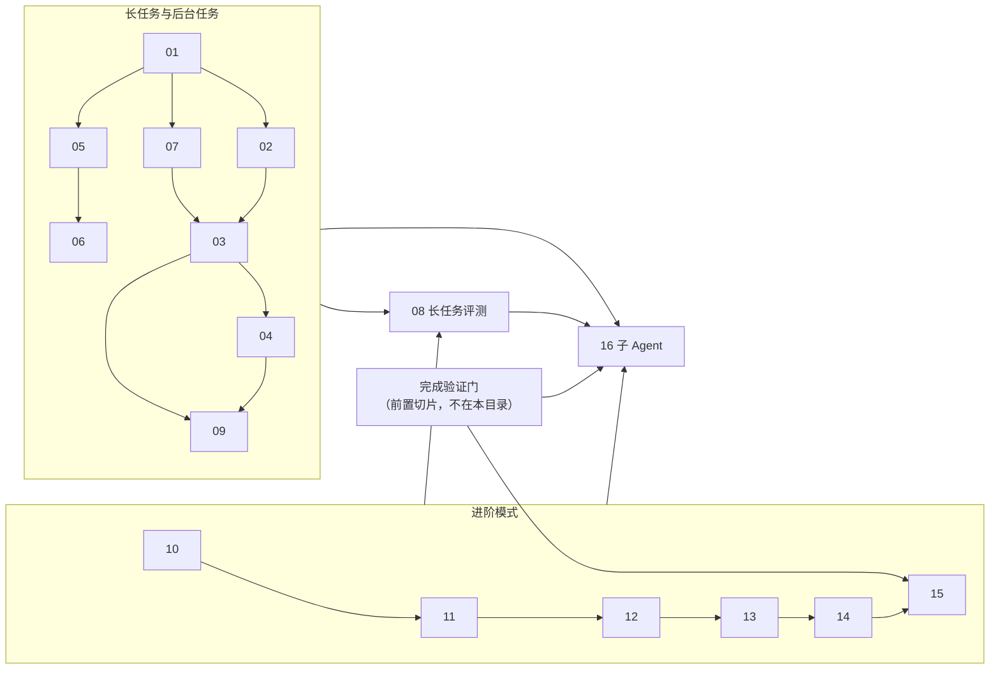

# 长任务、后台任务与进阶模式：分块讨论

> 状态：讨论稿集（2026-11-02；01–05 已部分确认、06–16 已按决策对齐，见各文档 §9）；不是 spec，未承诺实现，也未排期。
> 基线：当前工作树 HEAD `02a6b6c` + `core/`、`app/` 分域重构（`docs/HARNESS.md` 尚在未提交状态；本目录所有 `path:line` 均按当前工作树重新核对，`core/` 路径已同步到 `contracts/budget/context/task` 新布局）。
> 目的：把「长任务/后台任务还缺的 9 块」与「`/plan` 等进阶模式还缺的 6 块」逐块拆成**可独立评审、可独立拍板**的文档，并说明它们与未来 subAgent 的关系。

## 0 怎么用这份目录

- **逐块讨论**：每篇文档是独立单元，包含问题、现状证据、缺口、方案对比、最小实现切片、依赖关系、与子 Agent 的关系、待拍板问题。反馈时按编号（01–16）指出同意/反对/修改即可。
- **状态流转**：讨论稿（现在）→ 用户拍板/修改 → 收敛为 `docs/specs/` 下的实现切片 spec（每切片按项目规则补验收与测试）→ 实现。**本目录保留决策记录，不直接作为实现依据。**
- **不重复裁决已有规格**：`docs/specs/multi-agent-computer-use.md` 的 G0/M1/M2/M3、`verified-completion`、`goal-mode` 等仍是权威；本目录只在其上回答“长任务/后台/模式/委派还缺什么以及怎么接”。

> 进度：01–05 已确认（§9）；06–16 已完成对 01–05 的决策对齐（§9）；06–10 用户回答与 Lead 建议已确认（§10）；11–16 用户已回答（§11）。实现：任务运行时 P0 基础（TaskRecord/TaskStore）已完成，spec 见 [task-runtime](../../specs/task-runtime.md)；接下来的 integration/worker/goal spec 按 README §2 顺序推进。

## 1 结论地图

### 1.1 长任务与后台任务（9 块）

| # | 文档 | 一句话 | 关键推荐 | 主要依赖 |
|---|---|---|---|---|
| 01 | [任务运行时：编排权与任务模型](01-task-runtime.md) | `/goal` 编排全在 TUI，Python 只有单 run | 抽 Python `TaskRuntime`（TaskRecord + 生命周期 API），TUI 降为客户端；P0 默认关 | — |
| 02 | [后台进程监督与生命周期](02-process-supervision.md) | TUI 是当前唯一 supervisor，退出即按进程组 kill | `--worker` + 任务目录 + attach（ctrl.sock / pid / lock / 心跳 / 日志）+ 故障注入 | 01 |
| 03 | [无人值守审批：收件箱、归属与过期](03-unattended-approval.md) | 审批是同步回调，断连即拒绝，无队列 | 持久化审批收件箱 + 归属（task/id/origin）+ 过期/恢复；只自动放行配置能力，其余挂起 | 01, 07 |
| 04 | [隔离与并发：单写者、worktree 与合并门禁](04-isolation-concurrency.md) | 单工作区、单 active run，但多进程可同时写 | 每个写任务一个 git worktree + 单写者 + 合并门禁；只读任务可并发 | 01, 03 |
| 05 | [跨段目标状态与计划载体](05-goal-state.md) | goal 是自由文本，`goal.json` 只由 TUI 读写 | 独立 `GoalRecord`（验收标准/约束/段账本/阻塞/验证计划），v1 双写迁移 | 01 |
| 06 | [预算与成本账本](06-budget-ledger.md) | per-run 预算有；goal 累计只在 TUI 内存，漏记摘要/审计用量 | Python `BudgetLedger`（`budget.jsonl`、段/目标汇总、预留、硬上限、per-child） | 01, 05 |
| 07 | [控制面、异步协议与可观测](07-control-plane.md) | JSONL v1 单连接单 run，无 attach/任务事件 | v2 + capabilities 协商（兼容旧端）：任务生命周期帧、attach 快照、审批收件箱、控制 CLI | 01 |
| 08 | [长任务评测与验收](08-long-horizon-eval.md) | 现有六层验证都停在单 run/单题 | `scripts/bench_long.py` + scenario 配置 + 故障注入 + 门槛与成本 cap | 全部 |
| 09 | [无人值守安全默认值](09-unattended-safety.md) | 默认值是为交互设计的，后台直接复用会卡死或全自动 | 保守默认 profile + 能力分级 + 显式 opt-in + kill switch + 红队清单 | 03, 04 |

### 1.2 进阶模式（6 块）

| # | 文档 | 一句话 | 关键推荐 | 主要依赖 |
|---|---|---|---|---|
| 10 | [模式状态机](10-mode-state-machine.md) | harness 没有 mode 概念；`mode ≠ autonomy ≠ background` | run 级 `mode` + session 默认值；`chat/act/plan/goal` 转换表；P0 只做 chat/act | 01 |
| 11 | [模式契约：profile](11-mode-contracts.md) | 工具/审批/预算/提示词/完成策略今天分散在构造参数里 | 单一 `app/runtime/modes.py` profile registry；**执行层强制**；项目只能收紧 | 10 |
| 12 | [结构化 Plan 产物](12-plan-artifact.md) | `TaskState.plan` 只是模型写的字符串数组 | JSON 为事实源 + Markdown 渲染；`plan_id/version/steps`；生命周期与存储 | 11 |
| 13 | [计划审批门](13-plan-approval-gate.md) | 没有“先批准计划再执行”的 HITL 点 | 版本/hash/批准记录 + 未批准禁止写/执行 + steering→stale 重审 | 12 |
| 14 | [计划执行绑定](14-plan-execution-binding.md) | plan 与文件/验证证据没有绑定 | step ledger 证据化、偏离检测、重规划、步级预算、计划级完成条件 | 12, 13 |
| 15 | [计划验收与完成验证](15-plan-verification.md) | 步骤“完成”靠模型自述；缺验收映射 | 步骤验证 vs 计划验收分层；`acceptance_criteria → verification_plan`；**完成验证门是前置** | 14 + 验证门 |

### 1.3 跨主题

| # | 文档 | 一句话 | 关键推荐 |
|---|---|---|---|
| 16 | [子 Agent 的有机结合：任务节点](16-subagent-integration.md) | 子 Agent 与长任务/模式是同一基础设施的三个消费者 | 子 Agent = `TaskRecord.kind=subagent`；发起分三阶段（harness 内部→用户显式→模型工具）；只读优先、独立 worktree 写在后；**子报告是 untrusted claim，父侧 verify** |

## 2 依赖与建议顺序

建议顺序（讨论用，不是排期）：

1. **前置：完成验证门**（上一轮讨论的结论，不在本目录）。`verified` 只能来自可信命令/证据，这是 15 计划验收、16 子报告复核、08 评测口径的共同前提；建议先写它的 spec。
2. **运行时骨架**：01 任务模型、05 目标状态、06 预算账本，07 只读查询最小版。这一段决定“Python 是否成为编排权威”。
3. **后台闭环**：02 worker/attach、03 审批收件箱、04 worktree/单写者、09 安全默认值。四块必须一起验收，缺一不可。
4. **进阶模式**：10 模式状态机 → 11 profile → 12 Plan 产物 → 13 审批门 → 14 执行绑定 → 15 计划验收。
5. **验证与委派**：08 长任务评测与 16 子 Agent（16 的 P0 只读 runner 可以更早试做，因为它复用现有 auditor 原型，不依赖完整后台）。

> 不建议一次 change 同时改运行时、审批语义、预算语义与完成语义；按项目既有做法，每块单独 spec + 验收。

## 3 五条横向主线

1. **任务节点统一模型**：`run / goal / plan_step / subagent` 都是 `TaskRecord`（任务节点）；不再为每种任务写一套 loop 或一套 session。
2. **可信完成**：`verified` 只来自 harness 可复核的证据（可信验证命令 + 环境审计 + 可选契约反查），模型自述不参与；长任务/子 Agent 报告都是 claim。
3. **单写者 + 隔离**：任何时刻同一工作区只有一个写者；后台/子 Agent 的写只能发生在自己的 worktree，合并需门禁。
4. **无人值守默认保守**：默认只读 / 沙箱内 / 挂起等审批；“全自动”必须是显式、可审计的 opt-in，而不是为了跑通顺手开 `full`。
5. **能力边界在执行层**：模式/子 Agent 的工具、审批、预算、委派限制必须由 registry/approval/budget 强制，提示词只是告知。

## 4 第一批需要拍板的问题（按块）

**已拍板（01–05，2026-11-03）**

- **01 任务运行时**：Python TaskRuntime 为权威、TUI 退化为客户端；run/goal/plan/subagent 全部建模为 task；后台任务默认开启（范围已确认：`/goal` 与显式长任务，普通 `--task`/eval 一次性）；起步允许两个后台任务，写任务串行、只读并发；TUI 关闭需确认转入后台，worker 继续、不自动重跑已执行段。
- **02 进程监督**：每 task 一个 worker + per-workspace supervisor；TUI 退出提示“任务将转入后台”并需确认；启动检测到运行中任务时提示用户；attach 采用“单 controller + 多 observer”；日志按会话保留并加软上限。
- **03 无人值守审批**：后台写必须 worktree + 审批队列、默认挂起；required 审批过期 → 任务失败；预览存索引 + 确定性脱敏；`origin` 拆成 `requester`/`decider`；清理归 TaskRuntime。
- **04 隔离与并发**：P0/P1 workspace 单写者、只读并发，P2 再实验文件集并行；合并默认用户最终批准，策略自动合并仅 opt-in 且合并后必须重验；worktree 复用主环境；kill switch 以 CLI 为主 + `.vibe/stop` 兜底；非 git 已确认：P0 拒绝后台写/只读允许，P1 影子副本 + 自动 git 产出 diff。
- **05 目标状态**：`goal-record.json` 为权威；验收标准模型提议 + 用户确认；`open_items` 以 harness 证据为强证据；P0 沿用 done+verified，未来接验证门；段账本只留摘要。

**已确认（06–10，2026-11-03；处理见各文档 §10）**

- **06 预算账本**：三层预算——不可关闭的 global safety cap、task/goal 软预算（默认不直接失败）、run/segment 作为段边界；冲突优先级 global > task hard > run；P0 用 `llm_end` 聚合、P1 增 per-request compact 明细；摘要/审计成本优先强制计入；时间口径同时记录 active/wall；收尾固定 output cap；账本放 `app/runtime/`。
- **07 控制面**：v1/v2 双栈一个发布周期、先迁 TUI；P0 只 observe attach，后续允许纠偏/继续；回放先快照+提示；首版不做远程；capability 按类别声明，控制/审批缺失 fail closed，只读缺失降级；controller 租约 heartbeat 5s / TTL 15s。
- **08 长任务评测**：长任务定义为“≥2 段或 ≥1 次压缩或 wall-clock ≥30min”；合成故障任务为主 + 少量真实样本；恢复成功=`done+verified` 且无重复副作用，人工 `/resume` 单独报告不计失败；treatment vs `VIBE_TASK_RUNTIME=0` 对照；blocking fake 门禁 + advisory 真模型指标。
- **09 无人值守安全**：沙箱/worktree 内写入采用“创建时预授权 + 运行时通知/审计”；opt-in 仅本机用户可改、变更审计；`vibe task stop` SIGTERM→5s→SIGKILL，另有 `pause` 保留 worktree；凭据用安全前缀继承 + secret deny-list；events/trace 64MB/30 天、审批/审计 180 天；后台范围与 01 一致、非 git 按 04 确认。
- **10 模式状态机**：跨段不改 mode；入口记忆“项目级最近 mode + 会话覆盖”；`submit_plan` 需 UI 确认+审计；goal 作为正式 mode 暴露；goal 段内通过 `kind=plan` 子任务/plan artifact 使用 plan（方案 A，不切换 `task.mode`）；capability 协商 + fail closed，后续保留一种协议；完成语义在 15 验证门+用户确认 criteria 就绪后通过 feature flag 切换。

**11–16：用户已回答（2026-11-03，处理见各文档 §11）**

- **11 模式契约**：项目级覆盖 P2；plan profile 不允许 `update_task`；profile 不进 `verified`；后台写 task 记录 worktree/合并门禁字段。CLI 预算合并建议与“完成证据如何判定”说明待回执。
- **12 Plan 产物**：JSON；存 `kind=plan` task 目录；首次审批可编辑、批准后不可直接改文件；`submit_plan` 独立 UI 确认+审计。纯 plan task 的验收标准权威建议待回执；本地存储路径（项目 `.vibe` vs 全局用户数据）待确认。
- **13 计划审批门**：整份计划一次批准（破坏性步骤单独确认）；影响文件集/验收标准才重批；P0 无人值守只到只读+测试；goal 总时长包含审批等待（active/human 分记）；计划卡片默认折叠、分页、↑↓ 选择。TUI 右侧侧栏方案待回执。
- **14 执行绑定**：步骤粒度模型提议 + 审批裁决；偏离默认暂停；goal 段末未完成暂停。分层证据方案、步级预算（建议 10–12 steps/步、3 次重规划）待回执。
- **15 计划验收**：标准项目 profile 长期维护 + 每任务确认（只能收紧）；可信命令以项目 profile 为主、会话覆盖需批准；`manual` 挡住 verified 不阻断交付；required 子集 + 最终全量。重试/时间上限（建议 2 次/5 分钟）待回执。
- **16 子 Agent**：首批只读；P1 前只允许用户/harness 触发 `delegate`；子结果只进摘要+证据引用+结构化 findings；首版禁止嵌套 goal；模型路由属 Provider 层，暂缓。

**仍需你确认（11–16 建议回执）**

- 11：CLI 预算与 profile 冲突“取 min + 提示”；完成证据说明（说明性，无需决策）。
- 12：Plan 产物本地存储路径（项目 `.vibe` vs 全局用户数据）；纯 plan task 的验收标准权威（单一权威方案）。
- 13：TUI 右侧侧栏作为只读评审面板的方案。
- 14：分层证据方案；步级预算默认 10–12 steps/步、重规划 3 次。
- 15：每 criterion 重试 2 次、单条命令 ≤5 分钟。

**仍待实现时再定**：各块的 UI 细节、字段命名与具体数值；这些不阻断把已确认部分收敛成 spec。
