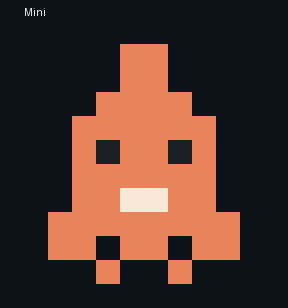

# TUI 首屏（工作台首页）

日期：2026-10-26。状态：设计并实现；真实终端视觉验收待用户确认。

## 目标

首屏不是一张帮助页，而是“现在在哪、可以做什么、怎么开始”的入口。保持 Ink 渐变分区与无框线视觉，不新增独立页面或动画。

## 产品标识：像素机器人 Mini

产品标识是一个**彩色像素机器人**，固定在顶部 header 左侧，随窗口尺寸切换两种形态。形象叫 **Mini**：小型、可识别、像素化的编码 Agent。

- 宽屏（`columns >= 96` 且 `rows >= 26`，header 5 行）：10×10 像素 sprite，用 `▀` 上下半格渲染成 5 行；身体珊瑚色、眼睛深墨色、嘴部米色；
- 窄屏（`columns >= 60`，header 3 行）：8×6 紧凑脸部 sprite，渲染成 3 行；
- 过窄/过矮：隐藏标识，保持文本优先；
- 无彩色终端：渲染器用空格/半格保留轮廓剪影，不依赖颜色识别；
- 旁边五行信息：产品名与状态、`先读后写 · 每一步都有证据`、工作区、模型 · provider、会话；
- 不使用图片、不依赖图标字体或终端图形协议，所有字符宽度为 1。

## 信息层级

1. **品牌与承诺**：`mini-harness · 个人编码工作台`，一句“先读后写 · 每一步都有证据 · 工具动作按权限审批”；说明“描述任务、范围与完成条件”。
2. **从这些开始**：三条可直接改写的 starter prompt（读 README、复现并修 bug、检查当前改动），优先于工作区信息展示。
3. **当前工作区**：项目路径、模型/provider、会话 ID 与恢复状态；与顶部 header 不重复强调，仅作为上下文。
4. **常用入口**：`/help`、`/context`、`/diff`、`/skills`、`/sidebar`、`/resume`。
5. **输入提示**：Enter 发送、Ctrl+J 换行、`/` 查看命令；窄屏使用短文案。

## 响应式

- `columns < 72`：纯文本分区（`▌` 标头 + 缩进行），避免卡片在窄屏挤占输入区；
- `columns >= 72`：使用现有 `cardLines` 卡片表面（hero/task/agent），首屏优先显示品牌与 starter prompt；
- 阅读区使用现有滚动条与 `ReadingPane`，不改变布局/快捷键。
- 首屏标题改为“工作台首页 · 输入任务开始”，输入框占位与底部 hint 同步改为“直接描述任务开始”。

## 测试

- `tui/tests/workbench.test.ts`：80 列包含品牌、starter、项目/模型；24–120 列不溢出；
- `tui/tests/visual-fixture.test.ts`：现有 80×24 welcome 快照仍保持每行终端宽度，并包含“描述任务”；
- `tui/tests/app.test.tsx`：32×12 窄屏仍有“输入/任务/开始/Ctrl”可读导航，不横向溢出；
- `tui/tests/mascot.test.tsx`：10×10 sprite 渲染 5 行、8×6 脸部渲染 3 行且不超宽。

## 未做

- 最近会话/最近任务列表（需要后端提供结构化最近记录）；
- Git 分支/未提交状态（侧栏已负责，首屏不重复启动 Git 查询）；
- 鼠标点击 starter prompt（当前走输入框与 `/` 命令菜单）。
